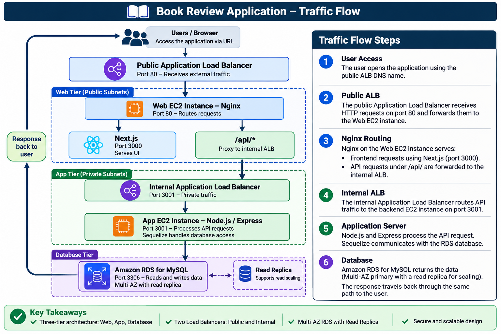

#Three-Tier Book Review Application on AWS

**Document status:** Draft — Deployment in Progress  
**Deployment method:** AWS Management Console and CLI  
**Architecture:** Three-tier (Web, App, Database)  
**Database:** Amazon RDS for MySQL, Multi-AZ with read replica  
**Prepared by:** Samkeliso Dube  
**AWS Region:** ```us-east-1``` 
**Upstream source:** `pravinmishraaws/book-review-app`  
**Deployment type:** Manual

---

## Book Review Deployment: Table of Contents

1. [Purpose](#1-purpose)
2. [Scope](#2-scope)
3. [Application Architecture](#3-application-architecture)
4. [Confirmed Source Code Details](#4-confirmed-source-code-details)
5. [Network Design](#5-network-design)
6. [Deployment Design](#6-deployment-design)
7. [Manual AWS Infrastructure Deployment](#7-manual-aws-infrastructure-deployment)
8. [Application Deployment](#8-application-deployment)
9. [Validation and Acceptance Criteria](#9-validation-and-acceptance-criteria)
10. [Evidence Checklist](#10-evidence-checklist)
11. [Teardown Procedure](#11-teardown-procedure)
12. [Deployment Log](#12-deployment-log)
13. [Troubleshooting Log](#13-troubleshooting-log)
14. [AWS Resource Register](#14-aws-resource-register)
15. [Time Record](#15-time-record)

---

## 1. Purpose

This document provides the step-by-step procedure for manually deploying the Book Review application on AWS. It records the infrastructure configuration, application deployment, validation, troubleshooting, and evidence collection for the three-tier architecture (Web, App, and Database), using a public Application Load Balancer, an internal Application Load Balancer, and Amazon RDS for MySQL with Multi-AZ and a read replica.

The steps are written as they are performed, and the commands and values reflect the final working configuration. Issues encountered are recorded in  `TROUBLESHOOTING.md`.

Each deployment phase is completed and verified before moving to the next phase.

## 2. Scope

This deployment includes:

- Amazon VPC and subnet configuration across two Availability Zones.
- Internet Gateway, NAT Gateway, and route tables.
- Security groups for each tier.
- Public Application Load Balancer.
- Web EC2 instance running Ubuntu, Nginx, and Next.js.
- Internal Application Load Balancer.
- Private App EC2 instance running Node.js and Express.
- Amazon RDS for MySQL with Multi-AZ and a read replica.
- Application configuration and testing.
- Deployment evidence and final teardown.

Terraform, Ansible, Docker, Kubernetes, and CI/CD are reserved for later project phases.

## 3. Application Architecture

### 3.1 Application components

| Tier | Component | Port | Responsibility |
|---|---|---:|---|
| Web | Nginx | 80 | Receives HTTP requests from the public ALB, serves the frontend, and proxies `/api/` requests to the internal ALB |
| Web | Next.js | 3000 | Serves the user interface, behind Nginx |
| App | Node.js and Express | 3001 | Application API (`/api/users`, `/api/books`, `/api/reviews`), with Sequelize as the database access layer |
| Database | MySQL on RDS | 3306 | Persistent data storage, Multi-AZ with read replica |

### 3.2 Traffic flow

The following diagram illustrates how requests travel
through the three-tier application architecture.



**Important:** The browser must not access the private internal ALB directly. Nginx will proxy `/api/*` requests to the internal ALB. We will verify this against the frontend source before configuring the production build.

## 4. Confirmed Source Code Details

| Item | Finding |
|---|---|
| Frontend framework | Next.js 15.2.3 |
| Frontend runtime | React ^19.0.0 |
| Frontend build | `npm run build` |
| Frontend production start | `npm run start` |
| Backend framework | Express 4 |
| Backend entry point | `backend/src/server.js` |
| Backend port | 3001 |
| Database library | Sequelize and MySQL2 |
| Database name | `book_review_db` |
| Database port | 3306 |
| Backend health endpoint | `GET` / - returns an API-running message |
| API routes | `/api/users`, `/api/books`, `/api/reviews` |

The backend currently uses Sequelize `sync({ alter: true })` and may seed sample data during startup. Review this behaviour before connecting to the persistent RDS database.

**Database warning**: Do not run against the RDS database until the sync behavior is reviewed. The `alter: true` option can modify existing table structures, potentially changing or removing columns.

The local `.env` configuration must not be copied unchanged to AWS. Use secure production credentials and the RDS endpoint.

## 5. Network Design

**VPC name:** `bookreview-vpc`
**VPC CIDR:** `10.0.0.0/16`
**DNS hostnames:** Enabled

| Component | Name | Configuration |
|---|---|---|
| VPC | `bookreview-vpc` | CIDR `10.0.0.0/16`, DNS resolution and DNS hostnames enabled |
| Subnets | See table below | Two AZs, two subnets per tier |
| Internet Gateway | `bookreview-igw` | Attached to `bookreview-vpc` |
| NAT Gateway | `bookreview-nat` | Public, in `bookreview-web-a`, with one Elastic IP owned by the gateway |
| Route tables | See table below | One per tier |
| Security groups | See table below | One per tier boundary |

| Subnet | Name | CIDR | Availability Zone | Type |
|---|---|---|---|---|
| Web A | `bookreview-web-a` | `10.0.1.0/24` | `<AZ-1>` | Public |
| Web B | `bookreview-web-b` | `10.0.2.0/24` | `<AZ-2>` | Public |
| App A | `bookreview-app-a` | `10.0.11.0/24` | `<AZ-1>` | Private |
| App B | `bookreview-app-b` | `10.0.12.0/24` | `<AZ-2>` | Private |
| DB A | `bookreview-db-a` | `10.0.21.0/24` | `<AZ-1>` | Private |
| DB B | `bookreview-db-b` | `10.0.22.0/24` | `<AZ-2>` | Private |

Subnet ranges were checked against the course IP calculation sheet before creation. No ranges overlap within `10.0.0.0/16`.

**Route tables**

| Route table | Associated subnets | Routes |
|---|---|---|
| `bookreview-public-rt` | Web A, Web B | `10.0.0.0/16` local, `0.0.0.0/0` to Internet Gateway |
| `bookreview-private-app-rt` | App A, App B | `10.0.0.0/16` local, `0.0.0.0/0` to NAT Gateway |
| `bookreview-private-db-rt` | DB A, DB B | `10.0.0.0/16` local only |

The DB route table has no internet route. The database does not need outbound internet access.

## 6. Design Decisions

| Component | Decision |
|---|---|
| Architecture | Three-tier |
| Public entry point | Internet-facing ALB, port 80 |
| Web tier | Ubuntu EC2 in public subnets, Nginx and Next.js |
| App entry point | Internal ALB, port 3001 |
| App tier | Private Ubuntu EC2, Node.js and Express |
| Database | Private Amazon RDS for MySQL |
| RDS availability | Multi-AZ |
| Read replica | One, single-AZ |
| Auto Scaling Groups | Not used (single instance per tier, per the assignment) |
| Elastic IPs | None on instances. The NAT Gateway uses one internally. |
| NAT Gateway | Required for App tier outbound access (`npm install`, Git clone) |
| HTTPS | Out of scope for this deployment stage |
| Deployment method | Manual |

**Cost note:** Multi-AZ, the read replica, the NAT Gateway, and two ALBs all bill while running. Keep the budget alert active and tear down the same day.

**One technical clarification for implementation:** The NAT Gateway provides outbound internet access for private instances. It does not make the App EC2 instance publicly accessible.

## 7. Security Groups

Create these security groups in `bookreview-vpc`. Outbound rules are left at the default (all traffic allowed).

| Security group | Inbound port | Source | Purpose |
|---|---:|---|---|
| `bookreview-alb-public-sg` | 80 | `0.0.0.0/0` | Internet to public ALB |
| `bookreview-web-sg` | 80 | `bookreview-alb-public-sg` | Public ALB to Nginx |
| `bookreview-alb-internal-sg` | 3001 | `bookreview-web-sg` | Nginx to internal ALB |
| `bookreview-app-sg` | 3001 | `bookreview-alb-internal-sg` | Internal ALB to Express |
| `bookreview-db-sg` | 3306 | `bookreview-app-sg` | Express to RDS |

No security group allows port 22. Administrative access uses Session Manager (Appendix A).

**Design notes**

- The NAT Gateway serves both App subnets from one AZ. This is a cost-saving choice for this practice deployment, not a highly available design. If `bookreview-web-a` fails, the App tier loses outbound access. Traffic from App B also crosses AZs and can incur data transfer charges. A production design uses one NAT Gateway per AZ.
- The database route table has no internet route.
- 
## 8. Deployment Procedure

### Phase 1 — Preparation

1. Confirm the AWS Region.
2. Confirm the source repository and commit to deploy.
3. Check the AWS budget alert.
4. Confirm the subnet CIDR plan.
5. Confirm the assignment's database availability requirements.
6. Confirm local environment files are excluded from Git.
7. Select cost-appropriate EC2 and RDS instance sizes.

**Evidence:**
- Repository and commit.
- AWS Region.
- Budget alert.
- Final network plan.

**Status:** Not started.

### Phase 2 — Create the VPC

1. Sign in to the AWS Management Console.
2. Search for `VPC`.
3. Open the VPC service.
4. Select **Your VPCs**.
5. Select **Create VPC**.
6. Choose to create a VPC only.
7. Enter `bookreview-vpc`.
8. Enter CIDR `10.0.0.0/16`.
9. Enable DNS resolution and DNS hostnames.
10. Create the VPC.

**Expected result:** The VPC is created and its CIDR is visible.

**Evidence:** `step01-vpc.png`

**Status:** Not started.

### Phase 3 — Create the six subnets

1. Open **VPC → Subnets**.
2. Select **Create subnet**.
3. Select `bookreview-vpc`.
4. Create the six subnets listed in Section 5.
5. Select the appropriate Availability Zone for each subnet.
6. Verify the CIDR ranges.
7. Enable automatic public IPv4 assignment only on the Web subnets if required by the chosen access design.

**Expected result:** Six subnets exist in the correct VPC.

**Evidence:** `step02-subnets.png`

**Status:** Not started.

### Phase 4 — Internet Gateway and route tables

1. Open **VPC → Internet Gateways**.
2. Create `bookreview-igw`.
3. Attach it to `bookreview-vpc`.
4. Open **Route Tables**.
5. Create `bookreview-public-rt`.
6. Add route `0.0.0.0/0` pointing to the Internet Gateway.
7. Associate both Web subnets.
8. Create `bookreview-private-app-rt` and associate both App subnets.
9. Create `bookreview-private-db-rt` and associate both DB subnets.
10. Keep the DB route table local-only.
11. Decide how the private App instance will obtain packages and source code before adding any NAT route.

**Expected result:** Public Web subnets have internet routing. Private App and DB subnets have no direct Internet Gateway route.

**Evidence:**
- `step03-igw.png`
- `step04-route-tables.png`

**Status:** Not started.

### Phase 5 — Security groups

1. Open **EC2 → Security Groups**.
2. Create the five security groups in Section 7.
3. Select the Book Review VPC for each group.
4. Configure the inbound rules.
5. Use security-group references for tier-to-tier communication.
6. Review all inbound rules.
7. Confirm only the public ALB accepts public HTTP traffic.

**Expected result:** Each tier only accepts the traffic it requires.

**Evidence:** `step05-security-groups.png`

**Status:** Not started.

### Phase 6 — Create RDS for MySQL

1. Open **RDS → Subnet groups**.
2. Select **Create DB subnet group**.
3. Create `bookreview-db-subnets`.
4. Select both private DB subnets.
5. Open **RDS → Databases → Create database**.
6. Select MySQL.
7. Select an appropriate engine version and instance class.
8. Configure the database identifier.
9. Configure secure master credentials.
10. Select `bookreview-db-subnets`.
11. Set public access to **No**.
12. Attach `db-sg`.
13. Select the approved availability option.
14. Create the database.
15. Wait for the database to become Available.
16. Record its endpoint and port without recording credentials.

Create a dedicated application database user. Do not use the RDS master account in the application.

**Expected result:** RDS is Available and private.

**Evidence:**
- `step06-rds-configuration.png`
- `step07-rds-available.png`

**Status:** Not started.

### Phase 7 — Deploy the App tier

1. Open **EC2 → Instances → Launch instances**.
2. Select an Ubuntu Server AMI.
3. Name the instance `bookreview-app`.
4. Select an appropriate instance type.
5. Select `bookreview-vpc`.
6. Select a private App subnet.
7. Do not assign a public IP.
8. Attach `app-sg`.
9. Configure the approved access method.
10. Launch the instance.
11. Access it using the approved private management method.
12. Install the required Node.js runtime and Git.
13. Transfer or clone the pinned source code.
14. Change to the `backend` directory.
15. Install dependencies using the lock file.
16. Create the production environment configuration securely.
17. Configure the RDS endpoint, database name, username and password.
18. Set `PORT=3001`.
19. Configure a strong JWT secret and allowed frontend origin.
20. Review database SSL settings and Sequelize startup behaviour.
21. Start the backend using the verified process-management approach.
22. Test the root endpoint locally.

Backend entry point:

```bash
node src/server.js
```

Expected health response:

```text
Book Review API is running...
```

**Expected result:** Backend is running on port 3001 and can authenticate to RDS.

**Evidence:**
- `step08-app-instance.png`
- `step09-backend-health.png`
- `step10-database-connectivity.png`

**Status:** Not started.

### Phase 8 — Create the Internal ALB

1. Open **EC2 → Target Groups**.
2. Create `bookreview-app-tg`.
3. Choose Instances as the target type.
4. Select HTTP and port `3001`.
5. Select the Book Review VPC.
6. Configure health check path `/`.
7. Register the App EC2 instance.
8. Open **EC2 → Load Balancers**.
9. Create an Application Load Balancer.
10. Name it `bookreview-internal-alb`.
11. Select **Internal**.
12. Select both private App subnets.
13. Attach `alb-internal-sg`.
14. Configure an HTTP listener on port `3001`.
15. Forward requests to `bookreview-app-tg`.
16. Wait for the App target to become healthy.
17. Record the internal ALB DNS name.

**Expected result:** Internal ALB successfully forwards traffic to the backend.

**Evidence:**
- `step11-app-target-group.png`
- `step12-internal-alb.png`
- `step13-app-healthy.png`

**Status:** Not started.

### Phase 9 — Deploy the Web tier

1. Open **EC2 → Instances → Launch instances**.
2. Select Ubuntu Server.
3. Name the instance `bookreview-web`.
4. Select an appropriate instance type.
5. Select `bookreview-vpc`.
6. Select a public Web subnet.
7. Configure public IP assignment according to the approved access design.
8. Attach `web-sg`.
9. Launch the instance.
10. Connect using the approved management method.
11. Install Node.js, Git and Nginx.
12. Transfer or clone the pinned source code.
13. Change to the `frontend` directory.
14. Install dependencies using the lock file.
15. Verify the frontend API configuration.
16. Configure the API URL to use the public same-origin path.
17. Build the Next.js application.
18. Start Next.js on local port `3000`.
19. Configure Nginx to forward frontend traffic to `127.0.0.1:3000`.
20. Configure Nginx `/api/` requests to forward to the internal ALB on port `3001`.
21. Test the Nginx configuration.

```bash
sudo nginx -t
```

22. Reload Nginx.
23. Confirm the service is active.

The browser must not call the private internal ALB directly. Verify the actual frontend source and `next.config.mjs` before finalising this configuration.

**Expected result:** Nginx serves the frontend and proxies API requests privately to the internal ALB.

**Evidence:**
- `step14-web-instance.png`
- `step15-nginx-config.png`
- `step16-frontend-test.png`

**Status:** Not started.

### Phase 10 — Create the Public ALB

1. Open **EC2 → Target Groups**.
2. Create `bookreview-web-tg`.
3. Choose Instances as the target type.
4. Select HTTP and port `80`.
5. Select the Book Review VPC.
6. Set health check path `/`.
7. Register the Web EC2 instance.
8. Open **EC2 → Load Balancers**.
9. Create an Application Load Balancer.
10. Name it `bookreview-public-alb`.
11. Select **Internet-facing**.
12. Select both public Web subnets.
13. Attach `alb-public-sg`.
14. Configure an HTTP listener on port `80`.
15. Forward traffic to `bookreview-web-tg`.
16. Wait for the ALB to become active.
17. Confirm the Web target is healthy.
18. Record the public ALB DNS name.

**Expected result:** The public ALB serves the frontend.

**Evidence:**
- `step17-public-alb.png`
- `step18-web-target-healthy.png`

**Status:** Not started.

### Phase 11 — End-to-end testing

Run the acceptance tests in Section 9.

Record actual results. Troubleshoot one failure at a time.

**Status:** Not started.

### Phase 12 — Final documentation and teardown

1. Complete the evidence checklist.
2. Record issues and resolutions.
3. Complete the assignment submission.
4. Confirm that the deployment is no longer needed.
5. Follow the teardown procedure.
6. Check for remaining billable resources.

**Status:** Not started.

## 9. Validation and Acceptance Criteria

| # | Test | Expected result | Result |
|---|---|---|---|
| 1 | Open `http://<PUBLIC_ALB_DNS>/` | Frontend loads | Pending |
| 2 | Request `/api/books` through public ALB | Expected JSON response | Pending |
| 3 | Register a test user | Registration succeeds | Pending |
| 4 | Log in | Authentication succeeds | Pending |
| 5 | Open a book and view reviews | Data loads | Pending |
| 6 | Submit a review | Review is saved and displayed | Pending |
| 7 | Public ALB target health | Healthy | Pending |
| 8 | Internal ALB target health | Healthy | Pending |
| 9 | App-to-RDS connectivity | Database authentication succeeds | Pending |
| 10 | App and DB public exposure | No public access | Pending |
| 11 | Security group review | Only intended traffic allowed | Pending |

Do not mark a test as passed until it has been executed.

## 10. Evidence Checklist

- [ ] VPC and CIDR.
- [ ] Six subnets and Availability Zones.
- [ ] Internet Gateway.
- [ ] Public and private route tables.
- [ ] Security group rules.
- [ ] Web EC2 details.
- [ ] App EC2 details and no public IP.
- [ ] RDS configuration and endpoint.
- [ ] Internal ALB and healthy App target.
- [ ] Public ALB and healthy Web target.
- [ ] Nginx configuration and successful test.
- [ ] Backend health check.
- [ ] Database connectivity.
- [ ] Working application UI.
- [ ] Successful API response.
- [ ] Teardown evidence.

Redact passwords, tokens, private keys and secrets before storing or sharing screenshots.

## 11. Teardown Procedure

Only begin teardown after deployment, testing and evidence collection are complete.

1. Delete the public ALB and internal ALB.
2. Delete their target groups.
3. Terminate the Web and App EC2 instances.
4. Delete any read replicas first, then the primary RDS database according to the approved snapshot decision.
5. Delete any NAT Gateway if one was created; confirm its Elastic IP is released.
6. Delete launch templates if any were created.
7. Delete security groups after dependencies are removed.
8. Delete non-default route tables after disassociating subnets.
9. Delete the subnets.
10. Detach and delete the Internet Gateway.
11. Delete the VPC.
12. Review AWS billing and cost views for remaining resources.

Record the teardown date and capture evidence. Deleting resources does not remove charges already incurred.

## 12. Deployment Log

| Date/time | Activity | Resource ID or value | Result / issue / resolution |
|---|---|---|---|
| | | | |

## 13. Troubleshooting Log

| Date/time | Symptom | Evidence checked | Root cause | Fix | Retest result |
|---|---|---|---|---|---|
| | | | | | |

## 14. AWS Resource Register

| Resource | Name | AWS ID / endpoint | Region / AZ | Status |
|---|---|---|---|---|
| VPC | `bookreview-vpc` | To be recorded | | Planned |
| Public ALB | `bookreview-public-alb` | To be recorded | | Planned |
| Internal ALB | `bookreview-internal-alb` | To be recorded | | Planned |
| Web EC2 | `bookreview-web` | To be recorded | | Planned |
| App EC2 | `bookreview-app` | To be recorded | | Planned |
| RDS | `bookreview-db` | To be recorded | | Planned |

---

## 12. Time Record

Times are recorded as they happen. Troubleshooting time is logged separately so the build time stays comparable across methods.

| Phase | Start | End | Build time | Troubleshooting time | Notes |
|---|---|---|---|---|---|
| App inspection and architecture | | | | | |
| VPC, subnets, route tables | | | | | |
| Internet Gateway and NAT Gateway | | | | | |
| Security groups | | | | | |
| RDS Multi-AZ and read replica | | | | | |
| App tier (EC2, internal ALB) | | | | | |
| Web tier (EC2, Nginx, public ALB) | | | | | |
| Validation | | | | | |
| Documentation and screenshots | | | | | |
| Teardown | | | | | |
| **Total** | | | **Total** | **Total** | |

Notes on the record:

- **Include RDS wait time** in the RDS row, since Multi-AZ provisioning runs in the background. Note any time you spent on other tasks while it provisioned.
- **Document time** is part of the total. Employers should see it, because a deployment without documentation isn't finished.
- **Use the same phase breakdown for Terraform and Docker** so the three totals can be compared row by row.
- **Note AI assistance** in the notes column for any phase where Claude generated the work, as described in `docs/ai-assistance.md`.

**Document control:** This is a live runbook. Update it with actual values, screenshots and test results as each stage is completed. Do not assume a step succeeded merely because AWS accepted the configuration.

## 8. Administrative Access to the Private App Instance

### 8.1 Goal

The App EC2 instance runs in a private subnet. It has no public IP address, and no route from the Internet Gateway reaches it. Its security group restricts application traffic to the internal ALB. Administrative access is configured separately, using one of the methods in this section.

Administrators still need a shell on the instance to install packages, deploy code, and troubleshoot. This section describes two supported ways to get that access without exposing the instance to the internet.

### 8.2 Available methods

| Method | Summary |
|---|---|
| Option A: Bastion host | A public EC2 instance acts as a jump host. You SSH to the bastion, then SSH from the bastion to the App instance. |
| Option B: Session Manager | AWS Systems Manager opens a shell session to the instance through the SSM agent. No inbound ports are needed. |

Read both options and follow only the one you choose. Section 8.6 records the option used in this deployment.

### 8.3 Option A: Bastion host

**Concept.** The bastion is the only instance in the VPC that accepts SSH from outside. It sits in a public subnet with a public IP. The App instance accepts SSH only from the bastion's security group. Access to the App instance therefore depends on reaching the bastion first.

**Advantages**

- Teaches the classic jump-host pattern used in many organisations.
- Shows how SSH keys, security group references, and private-network access work together.
- Works with any SSH client and needs no AWS CLI on the administrator's machine.

**Disadvantages**

- Port 22 is open on the bastion to your IP address.
- Adds an instance that must be patched, monitored, and paid for.
- Key files must be stored and protected. A leaked key grants access.
- Session activity is not logged by default.

**Prerequisites**

- The private key for each instance must be available to the SSH client. The bastion and the App instance can use the same key pair or different ones.
- Each key file must be on the machine running the SSH command.

**Implementation steps**

1. Create `bookreview-bastion-sg` in `bookreview-vpc`. Add an inbound rule for port 22 from `<YOUR_IP>/32`.
2. Launch `bookreview-bastion` (Ubuntu) in `bookreview-web-a`, a public subnet, with auto-assign public IP enabled and `bookreview-bastion-sg` attached.
3. Add an inbound rule to `bookreview-app-sg` for port 22 from `bookreview-bastion-sg`.
4. From your local machine, connect through the bastion. Use separate key files for each hop:

   ```bash
   ssh -i <APP_KEY_NAME>.pem \
     -o ProxyCommand="ssh -i <BASTION_KEY_NAME>.pem -W %h:%p ubuntu@<BASTION_PUBLIC_IP>" \
     ubuntu@<APP_PRIVATE_IP>
   ```

   If both instances use the same key pair, the shorter form works:

   ```bash
   ssh -i <KEY_NAME>.pem -J ubuntu@<BASTION_PUBLIC_IP> ubuntu@<APP_PRIVATE_IP>
   ```

5. Confirm the session is on the App instance:

   ```bash
   hostname
   ip addr show
   ```

**Evidence:** Bastion instance details, the inbound rule on `bookreview-app-sg` that references `bookreview-bastion-sg`, and the shell prompt on the App instance.

### 8.4 Option B: Session Manager

**Concept.** The App instance runs the SSM agent and has an IAM role that allows it to communicate with Systems Manager. An administrator starts a session through the AWS API. The connection goes out from the instance to AWS, so no inbound port is needed.

**Advantages**

- No inbound SSH port on any security group.
- No bastion instance to run, patch, or pay for.
- Access is controlled by IAM, so it can be revoked per user without changing keys.
- Sessions can be logged to CloudWatch Logs or S3.

**Disadvantages**

- The instance needs an IAM instance profile, and the SSM agent must be running.
- The instance must reach the SSM endpoints over outbound HTTPS, through the NAT Gateway or VPC endpoints.
- Command-line access needs the AWS CLI and the Session Manager plugin on the administrator's machine.
- It teaches AWS-specific tooling rather than general SSH jump-host practice.

**Prerequisites**

- **AWS Console:** can start a Session Manager shell without SSH configuration or the CLI.
- **AWS CLI:** required for the `aws ssm start-session` command.
- **Session Manager plugin:** required for interactive CLI sessions.
- **SSH over SSM (optional):** also needs the key pair, because the SSH session runs over the SSM tunnel.

**Implementation steps**

1. Create an IAM role for EC2 named `bookreview-app-ssm-role`, with the `AmazonSSMManagedInstanceCore` policy attached. This role is used only by the App instance.
2. Attach the role to the App instance through an instance profile. If you launch directly, attach it at launch or afterwards. If you use a launch template, set the instance profile in the template.
3. Confirm the App instance is registered. Check the connectivity checklist below if it is not.
4. Start a shell session. From the AWS Console, use **Systems Manager → Session Manager → Start session**. From the command line:

   ```bash
   aws ssm start-session --target <APP_INSTANCE_ID>
   ```

5. For SSH-style access (optional), add this to `~/.ssh/config` on your local machine:

   ```text
   Host <APP_INSTANCE_ID>
       User ubuntu
       IdentityFile ~/.ssh/<KEY_NAME>.pem
       ProxyCommand aws ssm start-session --target %h --document-name AWS-StartSSHSession --parameters portNumber=%p
   ```

   Then connect with `ssh <APP_INSTANCE_ID>`.

6. Confirm the shell prompt is on the App instance (`hostname`, `ip addr show`).

**Evidence:** Fleet Manager showing the App instance as Online, the IAM role attached to the instance, and the shell prompt on the App instance.

**SSM connectivity checklist.** The NAT Gateway route alone does not guarantee that an instance registers with Systems Manager. Check each item on the App instance if it does not appear in Fleet Manager:

- **IAM instance profile:** attached, and includes `AmazonSSMManagedInstanceCore`.
- **SSM Agent:** running. On Ubuntu, check with `sudo systemctl status snap.amazon-ssm-agent.amazon-ssm-agent.service`, or `amazon-ssm-agent` if the AMI installs it as a package.
- **DNS resolution:** `nslookup ssm.<REGION>.amazonaws.com` returns an address.
- **Outbound HTTPS (TCP 443):** `curl -I https://ssm.<REGION>.amazonaws.com` returns a response.
- **Route:** the private App route table has `0.0.0.0/0` pointing to the NAT Gateway.

If the Web instance is also managed through Session Manager, run the same checks on it and attach its own role, `bookreview-web-ssm-role`.

### 8.5 Comparison

| Factor | Option A: Bastion host | Option B: Session Manager |
|---|---|---|
| Inbound port 22 | Yes, on the bastion (from your IP) and on the App instance (from the bastion) | None |
| Extra EC2 instance | Yes | No |
| Key pair | Required | Required only for SSH-style access |
| Access control | Security groups and key files | IAM policies |
| Session logging | Manual | Built in, optional |
| Prerequisites on the instance | None beyond SSH | IAM role, SSM agent, outbound HTTPS |
| Prerequisites on the admin machine | SSH client | AWS Console, or AWS CLI and Session Manager plugin |
| Best for | Learning SSH jump hosts and key management | Learning IAM-controlled, no-open-port administration |

### 8.6 Implementation decision

**Option used in this deployment:** Option B, Session Manager.

**Reasons**

- No inbound SSH port is opened on any security group, which reduces the attack surface of the Web and App tiers.
- No bastion instance is needed, which lowers cost and removes one instance to maintain.
- Access is controlled through IAM, which fits the least-privilege requirement in this SOP.
- Session logging can be enabled to record administrative activity.

**Consequences for the rest of the SOP**

- Security group `bookreview-bastion-sg` is not created.
- Security group `bookreview-app-sg` has no port 22 rule.
- The App instance uses the `bookreview-app-ssm-role` instance profile.
- The Web instance, if managed through Session Manager, uses a separate role named `bookreview-web-ssm-role`.
- Private instances reach the SSM endpoints through the NAT Gateway.
- The database tier is not accessed through an operating system shell. Database administration uses the MySQL client from the App instance, as described in Section 9.

Option A is documented in full so that readers who want to learn the bastion pattern can follow it. Those steps were not performed in this deployment, and the bastion instance and its security group must not be created when implementing Option B.
