# 📚 Book Review Application

## ☁️ AWS Three-Tier Architecture: Manual Deployment

---

📌 **Document Status:** Completed  
🛠️ **Deployment Method:** AWS Management Console  
🏗️ **Architecture:** Three-Tier (Web | App | Database)  
🗄️ **Database:** Amazon RDS for MySQL : Multi-AZ with Read Replica  
👨🏽‍💻 **Prepared By:** Samkeliso Dube  
🌍 **AWS Region:** `us-east-1`  
📦 **Upstream Source:** [`pravinmishraaws/book-review-app`](https://github.com/pravinmishraaws/book-review-app)  
🚀 **Deployment Type:** Manual

---

<p align="center">
  <em>A practical, step-by-step implementation of a three-tier application architecture on AWS.</em>
</p>

---

## 🎯 1. Purpose

This document provides a practical guide to deploying the Book Review application on Amazon Web Services (AWS) using a manually configured three-tier architecture.

It documents the infrastructure setup, application deployment, database connectivity and validation procedures, together with the evidence collected during implementation.

## 📦 2. Scope

This deployment covers the manual provisioning and configuration of AWS resources required to host the Book Review application using a three-tier architecture.

The scope includes:

- **Networking:** VPC, subnets, Internet Gateway, NAT Gateway, route tables and security groups.
- **Load Balancing:** Public and internal Application Load Balancers.
- **Compute:** EC2 instances hosting the frontend and backend services.
- **Database:** Amazon RDS for MySQL with Multi-AZ deployment and a read replica.
- **Application Integration:** Frontend, backend and database connectivity.
- **Validation:** Application testing, infrastructure verification and deployment evidence.

This document focuses exclusively on the manual AWS deployment. Other cloud platforms and deployment approaches are documented separately.

## 🏗️ 3. Application Architecture

The Book Review application follows a three-tier architecture consisting of a Web Tier, Application Tier and Database Tier.

Each tier performs a specific function and communicates with the next tier through controlled network connections.

### 3.1 Architecture Components

- **Web Tier:** Hosts the Next.js frontend using Nginx on an Amazon EC2 instance.
- **Application Tier:** Runs the Node.js and Express backend on a private Amazon EC2 instance.
- **Database Tier:** Uses Amazon RDS for MySQL to store application data, with Multi-AZ deployment and a read replica.

### 3.2 Request Flow

1. Users access the application through the public Application Load Balancer.
2. The load balancer forwards HTTP traffic to the Web Tier.
3. Nginx serves the frontend and forwards API requests to the internal Application Load Balancer.
4. The internal load balancer forwards requests to the backend service.
5. The backend communicates with Amazon RDS to retrieve and store application data.
6. Responses return through the application and web tiers to the user.

### 3.3 Architecture Diagram


## 🔍 4. Confirmed Source Code Details

The Book Review application is built using the following technologies and configurations:

### 4.1 Frontend

- **Framework:** Next.js 15.2.3
- **Library:** React 19
- **Production Build:** `npm run build`
- **Production Start:** `npm run start`

### 4.2 Backend

- **Runtime:** Node.js
- **Framework:** Express.js 4
- **Port:** `3001`
- **Database Integration:** Sequelize ORM with MySQL2
- **Entry Point:** `backend/src/server.js`

### 4.3 Database

- **Database Engine:** MySQL
- **Database Name:** `book_review_db`
- **ORM:** Sequelize

### 4.4 API Routes

The backend exposes the following API routes:

- `/api/users`
- `/api/books`
- `/api/reviews`

These details were identified from the application source code and are used as the reference for the AWS deployment.

## 🌐 5. Network Design

The Book Review application is deployed within a dedicated Amazon VPC across two Availability Zones in the `us-east-1` region. The network is divided into public, private application and private database subnets to provide isolation between the application tiers.

### 5.1 VPC Configuration

| Configuration | Value |
|:---|:---|
| VPC Name | `bookreview-vpc` |
| IPv4 CIDR | `10.0.0.0/16` |
| AWS Region | `us-east-1` |
| Availability Zones | `us-east-1a`, `us-east-1b` |
| DNS Hostnames | Enabled |

### 5.2 Subnet Configuration

| Tier | Subnet Name | CIDR Block | Availability Zone |
|:---|:---|:---|:---|
| Public Web | `bookreview-web-a` | `10.0.1.0/24` | `us-east-1a` |
| Public Web | `bookreview-web-b` | `10.0.2.0/24` | `us-east-1b` |
| Private App | `bookreview-app-a` | `10.0.11.0/24` | `us-east-1a` |
| Private App | `bookreview-app-b` | `10.0.12.0/24` | `us-east-1b` |
| Private DB | `bookreview-db-a` | `10.0.21.0/24` | `us-east-1a` |
| Private DB | `bookreview-db-b` | `10.0.22.0/24` | `us-east-1b` |

### 5.3 Network Components

| Component | Resource Name | Purpose |
|:---|:---|:---|
| Internet Gateway | `bookreview-igw` | Provides internet connectivity to public subnets. |
| NAT Gateway | `bookreview-nat` | Allows private application resources to initiate outbound internet connections. |
| Elastic IP | `bookreview-nat-eip` | Provides a static public IP address for the NAT Gateway. |
| Public Route Table | `public-rt` | Routes internet-bound traffic through the Internet Gateway. |
| Private App Route Table | `private-app-rt` | Routes outbound internet traffic through the NAT Gateway. |
| Private DB Route Table | `private-db-rt` | Keeps database subnet traffic within the VPC. |

### 5.4 Network Isolation

The network uses the following isolation controls:

- **Public Web Subnets:** Host internet-facing resources such as the public Application Load Balancer.
- **Private Application Subnets:** Host backend application resources without direct public internet access.
- **Private Database Subnets:** Host database resources with no direct public internet access.
- **Security Groups:** Control traffic between the web, application and database tiers.

### 5.5 Database Network and Availability Design

The database tier uses Amazon RDS for MySQL within the private database subnets. The primary database is configured for Multi-AZ deployment, with a separate read replica to support read operations.

**Database Configuration:**

| Configuration | Value |
|:---|:---|
| Database Service | Amazon RDS for MySQL |
| Primary DB Identifier | `bookreview-db` |
| Database Name | `book_review_db` |
| Deployment Model | Multi-AZ |
| Read Replica | `bookreview-db-replica` |
| Primary Availability Zone | `us-east-1a` |
| Read Replica Availability Zone | `us-east-1b` |
| Public Accessibility | Disabled |
| Database Port | `3306` |

**Database Architecture:**

1. **Primary Database:** Handles application read and write operations.
2. **Multi-AZ Standby:** Maintained in a separate Availability Zone to support automatic failover.
3. **Read Replica:** A separate database instance that can handle read workloads.

**Database Connectivity:**

- The backend application connects to the primary RDS database using MySQL on port `3306`.
- The database security group allows inbound MySQL traffic from the application security group.
- The database remains in private subnets and is not publicly accessible.

**Important:** The Multi-AZ standby and read replica serve different purposes. Multi-AZ supports availability and failover, while the read replica supports read scaling.
## ☁️ 6. Manual AWS Infrastructure Deployment

This section documents the step-by-step provisioning and configuration of the AWS infrastructure required to host the Book Review application.

The implementation follows the architecture and network design defined in **Sections 3 and 5**. Each phase includes its configuration steps and verification criteria before proceeding to the next phase.

### Phase 1: Preparation

Before provisioning AWS resources, confirm the application source, deployment configuration, network plan and estimated infrastructure costs.

**Preparation Steps**

1. **Confirm the AWS Region:** Use `us-east-1` throughout the deployment.
2. **Confirm the Source Repository:** Verify the upstream repository and identify the Git commit to be deployed.
3. **Check AWS Budget:** Confirm that the AWS budget alert is configured and review the estimated deployment costs.
4. **Review the Network Plan:** Confirm the VPC CIDR and six subnet allocations documented in **Section 5.2**.
5. **Review the Database Design:** Confirm the RDS Multi-AZ configuration and read replica documented in **Section 5.5**.
6. **Check Environment Files:** Ensure local `.env` files and application secrets are excluded from Git.
7. **Confirm Instance Sizes:** Select cost-appropriate EC2 and RDS instance classes before provisioning.

**Expected Result**

All deployment prerequisites are reviewed and confirmed before proceeding with AWS infrastructure provisioning.

---

### Phase 2: Create the VPC

**Objective**

Create the dedicated Amazon VPC that will host the Book Review application's web, application and database tiers.

**Steps**

1. Sign in to the [AWS Management Console](https://aws.amazon.com/console/).
2. Search for **VPC** and open the VPC service.
3. From the navigation pane, select **Your VPCs**.
4. Select **Create VPC**.
5. Under Resources to create, choose **VPC only**.
6. Enter `bookreview-vpc` as the VPC name.
7. Set the IPv4 CIDR block to `10.0.0.0/16`.
8. Leave IPv6 CIDR block set to **No IPv6 CIDR block**.
9. Leave Tenancy set to **Default**.
10. Select **Create VPC**.
11. Select the newly created VPC.
12. Choose **Actions → Edit VPC settings**.
13. Enable **DNS resolution** and **DNS hostnames**.
14. Save the changes.

**Verification**

Confirm that:

- The VPC is named `bookreview-vpc`.
- The IPv4 CIDR block is `10.0.0.0/16`.
- DNS resolution is enabled.
- DNS hostnames are enabled.

**Expected Result**

The `bookreview-vpc` VPC is successfully created with the required CIDR range and DNS settings.

**Evidence:** 

`bookreview-vpc.png`


---

### Phase 3: Create the Six Subnets

**Objective:** Create six subnets within `bookreview-vpc`, distributed across two Availability Zones to support the web, application and database tiers.

**Steps:**

1. Open the **VPC** service in the AWS Management Console.
2. From the navigation pane, select **Subnets**.
3. Click **Create subnet**.
4. Select `bookreview-vpc` as the VPC.
5. Create the six subnets using the configuration in [Section 5.2 : Subnet Configuration](#52-subnet-configuration).

| Subnet | Availability Zone | IPv4 CIDR |
|:---|:---|:---|
| `bookreview-web-a` | us-east-1a | `10.0.1.0/24` |
| `bookreview-web-b` | us-east-1b | `10.0.2.0/24` |
| `bookreview-app-a` | us-east-1a | `10.0.11.0/24` |
| `bookreview-app-b` | us-east-1b | `10.0.12.0/24` |
| `bookreview-db-a` | us-east-1a | `10.0.21.0/24` |
| `bookreview-db-b` | us-east-1b | `10.0.22.0/24` |

6. For each subnet, enter its name, select the specified Availability Zone and enter its IPv4 CIDR block.
7. Click **Create subnet**.
8. After creation, select each subnet and open **Actions → Edit subnet settings**.
9. Ensure **Enable auto-assign public IPv4 address** is disabled for all six subnets.
10. Save the settings.

**Verification:**

- Confirm all six subnets are listed under `bookreview-vpc`.
- Confirm each subnet has the correct CIDR block and Availability Zone.
- Confirm automatic public IPv4 assignment is disabled for all six subnets.

**Expected result:** Six subnets exist in `bookreview-vpc` with the correct Availability Zones and CIDR ranges.

**Evidence:** `bookreview-subnets.png`


---

### Phase 4: Configure the Internet Gateway, NAT Gateway and Route Tables

**Objective:** Configure internet connectivity for the public subnets and controlled outbound access for the private application subnets.

**Steps:**

**1. Create and attach the Internet Gateway**

1. Open **VPC → Internet Gateways**.
2. Click **Create internet gateway**.
3. Enter the name `bookreview-igw`.
4. Create the Internet Gateway.
5. Select the newly created gateway and choose **Actions → Attach to a VPC**.
6. Select `bookreview-vpc` and attach it.

**2. Create the NAT Gateway**

1. Open **VPC → NAT Gateways**.
2. Click **Create NAT Gateway**.
3. Enter the name `bookreview-nat`.
4. Under **Availability mode**, select **Zonal** (not Regional).
5. Select `bookreview-web-a` as the subnet.
6. Set connectivity type to **Public**.
7. Allocate or select an Elastic IP address named `bookreview-nat-eip`.
8. Create the NAT Gateway.
9. Wait until its status changes to **Available**.

**3. Configure the Public Route Table**

1. Open **VPC → Route Tables**.
2. Create a route table named `public-rt` in `bookreview-vpc`.
3. Open its **Routes** tab and choose **Edit routes**.
4. Add the route:
   - Destination: `0.0.0.0/0`
   - Target: `bookreview-igw`
5. Save the changes.
6. Under **Subnet associations**, associate:
   - `bookreview-web-a`
   - `bookreview-web-b`

**4. Configure the Private Application Route Table**

1. Create a route table named `private-app-rt` in `bookreview-vpc`.
2. Open its **Routes** tab and choose **Edit routes**.
3. Add the route:
   - Destination: `0.0.0.0/0`
   - Target: `bookreview-nat`
4. Save the changes.
5. Associate:
   - `bookreview-app-a`
   - `bookreview-app-b`

**5. Configure the Private Database Route Table**

1. Create a route table named `private-db-rt` in `bookreview-vpc`.
2. Keep the default local route for `10.0.0.0/16`.
3. Do not add an Internet Gateway or NAT Gateway route.
4. Associate:
   - `bookreview-db-a`
   - `bookreview-db-b`

**Verification:**

- Confirm `bookreview-igw` is attached to `bookreview-vpc`.
- Confirm `bookreview-nat` is Available in `bookreview-web-a`.
- Confirm `public-rt` routes `0.0.0.0/0` to the Internet Gateway.
- Confirm `private-app-rt` routes `0.0.0.0/0` to the NAT Gateway.
- Confirm `private-db-rt` contains only the local VPC route.
- Confirm all six subnets are associated with their intended route tables.

**Expected Result:** Public web subnets have an Internet Gateway route, private application subnets have controlled outbound access through the NAT Gateway, and database subnets remain isolated from internet routes.

**Evidence:**

 `bookreview-igw.png`

  

 `bookreview-nat-gateway.png`

  

 `bookreview-route-tables.png`

  

---

### Phase 5: Create and Configure Security Groups

**Objective:** Create security groups to control traffic between the public load balancer, web tier, internal load balancer, application tier and database tier.

**1. Open the Security Groups page**

1. Open the **VPC** service in the AWS Management Console.
2. From the navigation pane, select **Security Groups**.
3. Click **Create security group**.
4. Select `bookreview-vpc` as the VPC.
5. Create the five security groups listed below.

**2. Create the Security Groups**

| Security Group Name | Purpose |
|:---|:---|
| `bookreview-alb-public-sg` | Controls inbound traffic to the public Application Load Balancer. |
| `web-sg` | Controls traffic reaching the web EC2 instance. |
| `alb-internal-sg` | Controls traffic reaching the internal Application Load Balancer. |
| `app-sg` | Controls traffic reaching the backend EC2 instance. |
| `db-sg` | Controls traffic reaching the RDS database. |

**3. Configure Inbound Rules**

Configure the following inbound rules for each security group:

| Security Group | Type | Port | Source |
|:---|:---|---:|:---|
| `bookreview-alb-public-sg` | HTTP | 80 | `0.0.0.0/0` |
| `web-sg` | HTTP | 80 | `bookreview-alb-public-sg` |
| `alb-internal-sg` | Custom TCP | 3001 | `web-sg` |
| `app-sg` | Custom TCP | 3001 | `alb-internal-sg` |
| `db-sg` | MySQL/Aurora | 3306 | `app-sg` |

For each rule:

1. Open the relevant security group.
2. Select **Inbound rules → Edit inbound rules**.
3. Add the specified rule.
4. Select the corresponding security group as the source where indicated.
5. Save the rules.

**4. Review Outbound Rules**

Keep the default outbound rules unless the deployment requires a specific restriction. Review them to ensure the application components can communicate with their required dependencies.

**Verification:**

- Confirm all five security groups belong to `bookreview-vpc`.
- Confirm each inbound rule uses the correct port and source.
- Confirm traffic between application tiers is controlled through security group references rather than manually entered private IP addresses.
- Confirm the database accepts MySQL traffic only from `app-sg`.
- Do not add public inbound access to the application or database tiers.

**Expected Result:** Five security groups are created and configured to enforce the intended traffic flow between the application tiers.

**Evidence:** `bookreview-security-groups.png`


---

### Phase 6: Create RDS for MySQL

**Objective:** Create a private Amazon RDS MySQL database with Multi-AZ deployment and a read replica. The database must be accessible only from the App tier.

#### Step 1: Create the DB subnet group

1. Open **Amazon RDS → Subnet groups**.
2. Select **Create DB subnet group**.
3. Enter the following configuration:

| Setting | Value |
|:---|:---|
| Name | `bookreview-db-subnets` |
| VPC | `bookreview-vpc` |
| Subnets | `bookreview-db-a`, `bookreview-db-b` |

4. Select **Create**.

#### Step 2: Create the primary MySQL database

1. Open **RDS → Databases** and select **Create database**.
2. Choose **Full configuration**.
3. Under Engine options, select **MySQL** and MySQL Community Edition.
4. Under Templates, select **Dev/Test** or retain the appropriate low-cost default.
5. Under Availability and durability, select **Multi-AZ DB instance deployment (2 instances)**. Do not select the Multi-AZ DB cluster option.
6. Configure the database settings:

| Setting | Value |
|:---|:---|
| DB instance identifier | `bookreview-db` |
| Engine version | MySQL 8.4 |
| Master username | `admin` |
| Credentials management | Self managed |
| DB instance class | `db.t3.micro` |
| Storage type | General Purpose SSD (gp3) |
| Allocated storage | 20 GiB |

7. Create a strong master password and store it securely. Do not include the password in this document, screenshots, or Git repository.
8. Under Storage, leave storage autoscaling disabled.
9. Under Connectivity, configure:

| Setting | Value |
|:---|:---|
| Compute resource | Don't connect to an EC2 compute resource |
| VPC | `bookreview-vpc` |
| DB subnet group | `bookreview-db-subnets` |
| Public access | No |
| VPC security group | Choose existing: `bookreview-db-sg` |

10. Remove the default security group if it is automatically selected. Retain `bookreview-db-sg`.
11. Leave the certificate authority at its default.
12. Under Monitoring, select **Database Insights - Standard**. Leave Enhanced Monitoring off and log exports unchecked.
13. Under Additional configuration:
    - Initial database name: `book_review_db`
    - DB parameter group: `default.mysql8.4`
    - Option group: `default:mysql-8-4`
    - Keep encryption enabled with the default KMS key.
    - Keep automated backups enabled and set the retention period to 1 day.
    - Leave cross-Region backup replication disabled.
    - Leave automatic minor version upgrades enabled.
    - Enable deletion protection.
14. Review the configuration and select **Create database**.
15. Wait until `bookreview-db` reaches **Available**.
16. Record the database endpoint and port for the application configuration. Do not record credentials.
17. Create a dedicated application database user. Do not use the `admin` master account in the application.
    
---

#### Step 3: Create the read replica

1. Open **RDS → Databases**.
2. Select `bookreview-db`.
3. Choose **Actions → Create read replica**. Do not select the Aurora read replica option.
4. Configure the replica:

| Setting | Value |
|:---|:---|
| Source DB instance | `bookreview-db` |
| DB instance identifier | `bookreview-db-replica` |
| DB instance class | `db.t3.micro` |
| Destination Region | US East (N. Virginia) |
| Storage type | General Purpose SSD (gp3) |
| Allocated storage | 20 GiB |
| Deployment option | Single-AZ DB instance deployment |
| DB subnet group | `bookreview-db-subnets` |
| Public access | No |
| VPC security group | `bookreview-db-sg` |
| Database authentication | Password authentication |
| Database Insights | Standard |

5. Leave Enhanced Monitoring off and log exports unchecked.
6. Keep encryption enabled with the default KMS key, matching the primary database.
7. Leave automatic minor version upgrades enabled.
8. Enable deletion protection.
9. Add the tag `Name = bookreview-db-replica`.
10. Select **Create read replica** and wait until its status is **Available**.
11. Check the **Region & AZ** column. The intended placement is `us-east-1b`. If AWS places it in another Availability Zone, record the actual placement in the Deployment Log rather than recreating it unnecessarily.

#### Verification

Confirm that:

- The DB subnet group contains `bookreview-db-a` and `bookreview-db-b`.
- `bookreview-db` is Available and configured as a Multi-AZ DB instance deployment.
- The initial database name is `book_review_db`.
- The primary database is not publicly accessible.
- The primary database uses `bookreview-db-sg`.
- The read replica `bookreview-db-replica` is Available and not publicly accessible.
- Both databases are in the intended VPC.
- The database endpoint and port have been recorded securely, without recording passwords.

**Expected result:** The primary MySQL database is Available with Multi-AZ deployment enabled. The read replica is also Available, privately accessible within the VPC, and configured as a Single-AZ DB instance.

**Evidence:**

 `bookreview-rds-configuration.png`

  

 `bookreview-rds-available.png`

  

  `bookreview-read-replica.png`

  

---

### Phase 7: Create the Bastion Host

**Objectives:**

The objective of this phase is to create a bastion host for secure access to the private EC2 instances. This will allow us to connect to the private App instance and deploy the backend application without exposing it directly to the internet.

**Steps:**

1. Open **EC2 → Key pairs** and create a key pair named `bookreview-key`.
   - Key pair type: RSA
   - Private key file format: `.pem`
   - Download the key and store it securely outside the project repository.

2. Create a security group named `bookreview-bastion-sg` in `bookreview-vpc`:
   - Inbound rule: SSH (TCP 22), source: your current public IP address (`x.x.x.x/32`).
   - Outbound rules: leave the default settings.

3. Open `bookreview-app-sg` and add an inbound rule:
   - Type: SSH
   - Port: `22`
   - Source: `bookreview-bastion-sg`
   - Save the rule.

**Note:** This allows the bastion host to establish SSH connections to the private App instance without allowing direct SSH access from the internet.

4. Launch an EC2 instance named `bookreview-bastion` with the following configuration:
   - AMI: Ubuntu Server 24.04 LTS
   - Instance type: `t3.micro`
   - Key pair: `bookreview-key`
   - VPC: `bookreview-vpc`
   - Subnet: `bookreview-web-a` (`us-east-1a`)
   - Auto-assign public IP: Enable for this instance only.
   - Security group: `bookreview-bastion-sg`

5. Wait until the instance reaches the **Running** state and record its public and private IP addresses.

6. Connect to the bastion host through SSH and confirm that access is working.

7. Once the App EC2 instance has been created in Phase 8, use the bastion host to connect to it through its private IP address. Do not copy or leave the private key on the bastion host.

**Expected result:**

The `bookreview-bastion` instance is running in the public subnet with a public IP address. SSH access to the bastion is restricted to your public IP, while the private App instance accepts SSH connections only from `bookreview-bastion-sg`.

**Evidence:**

  `bookreview-bastion.png`

  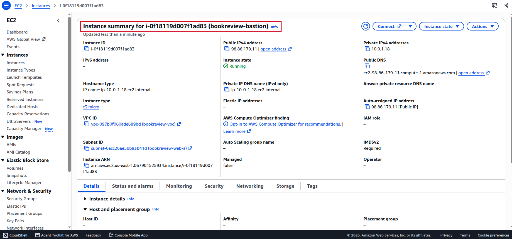

  `bookreview-app-sg-rules.png`

  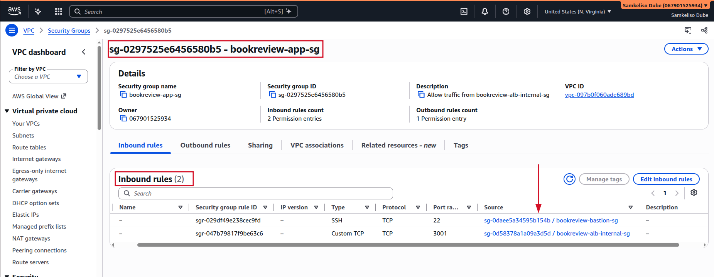

---

### Phase 8: Launch the App EC2 Instance

**Objectives:**

Launch the private App EC2 instance that will host the Node.js and Express backend. The instance will run inside the private App subnet and will be accessed securely through the bastion host.

**Steps:**

1. Open **EC2 → Instances** in the AWS Management Console.

2. Select **Launch instances**.

3. Enter the instance name:
   - Name: `bookreview-app`

4. Under **Application and OS Images (AMI)**, select:
   - Ubuntu Server 24.04 LTS.

5. Under **Instance type**, select:
   - `t3.micro`

6. Under **Key pair**, select:
   - `bookreview-key`

7. Under **Network settings**, configure:
   - VPC: `bookreview-vpc`
   - Subnet: `bookreview-app-a` (`us-east-1a`)
   - Auto-assign public IP: **Disable**
   - Firewall (security group): Select existing security group `bookreview-app-sg`.

8. Confirm that `bookreview-app-sg` has the required inbound rules:
   - TCP `3001` from `bookreview-alb-internal-sg` for backend traffic.
   - TCP `22` from `bookreview-bastion-sg` for secure SSH access through the bastion host.

9. Under **Advanced details**, leave the IAM instance profile unset for this deployment.

10. Review the instance configuration and select **Launch instance**.

11. Wait until the instance reaches the **Running** state and passes its status checks.

12. Select `bookreview-app` and record its instance ID and private IPv4 address. Confirm that it has no public IPv4 address.

**Expected result:**

The `bookreview-app` instance is running in the private subnet `bookreview-app-a`, has no public IP address, and is associated with `bookreview-app-sg`. It is ready for secure access through the bastion host and backend deployment in Phase 9.

**Evidence:**

  `bookreview-app-instance.png`

  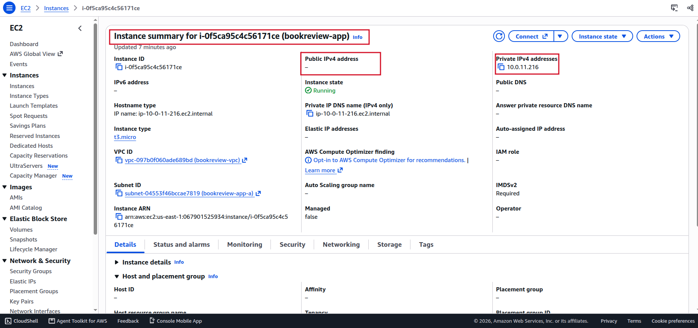

### Phase 9: Deploy the Backend and Verify Database Connectivity

**Objectives**

The objective of this phase is to deploy the Node.js and Express backend on the private App EC2 instance and establish connectivity with the Amazon RDS MySQL database. This will allow the backend application to process API requests and securely store and retrieve application data.

**Steps**

**1. Connect to the Private App Instance Through the Bastion Host**

The private App EC2 instance does not have a public IP address. Access it through the bastion host created in Phase 7.

During this deployment, the SSH `ProxyCommand` method was used to establish a connection directly through the bastion host:

```bash
ssh -i <KEY_PATH>/bookreview-key.pem \
  -o IdentitiesOnly=yes \
  -o 'ProxyCommand=ssh -i <KEY_PATH>/bookreview-key.pem -o IdentitiesOnly=yes -W %h:%p ubuntu@<BASTION_PUBLIC_IP>' \
  ubuntu@<APP_PRIVATE_IP>
```

This command routes the SSH connection through the bastion host without requiring a separate interactive SSH session.

**Security note:** Keep the private key on the local machine. Do not copy `bookreview-key.pem` onto the bastion host or the private App instance.

**2. Update the App Instance**

Update the Ubuntu package lists and install the required utilities:

```bash
sudo apt update
sudo apt install -y git mysql-client
```

**3. Install Node.js and npm**

Install the appropriate Node.js LTS version required by the application.

Verify the installation:

```bash
node -v
npm -v
```

Record the installed Node.js version in the Deployment Log.

**4. Clone the Application Repository**

Clone the Book Review repository:

```bash
git clone https://github.com/pravinmishraaws/book-review-app.git
```

Navigate to the backend directory:

```bash
cd book-review-app/backend
```

Check out the pinned commit recorded in Phase 1:

```bash
git checkout <PINNED_COMMIT>
```

**5. Install Backend Dependencies**

Install the dependencies using the package lock file:

```bash
npm ci
```

**6. Configure the Backend Environment Variables**

Create the backend `.env` file:

```bash
nano .env
```

Configure the database connection and application settings using the environment variable names expected by the backend source code:

```bash
# Database Configuration
DB_HOST=<RDS_ENDPOINT>
DB_NAME=book_review_db
DB_USER=admin
DB_PASS=<MASTER_PASSWORD>
DB_DIALECT=mysql

# Application Port
PORT=3001

# JWT Secret for Authentication
JWT_SECRET=<LONG_RANDOM_STRING>

# Allowed Origins for CORS (update in Phase 11)
ALLOWED_ORIGINS=http://localhost:3000
```

The application uses the RDS master account in this deployment as a lab simplification. This is documented in Section 6.

Protect the environment file:

```bash
chmod 600 .env
```

Do not commit `.env` to GitHub or expose database credentials and secrets in deployment screenshots.

**7. Check the Database Configuration Before Starting the Backend**

In `src/server.js`, replace `sync({ alter: true })` with `sync()` for the User, Book and Review models.

Verify the changes:

```bash
grep -n "sync(" src/server.js
```

This modification prevents Sequelize from automatically altering existing database tables during application startup. Record the change in Section 4 and the Troubleshooting Log (T-04).

**8. Install PM2**

Install PM2 globally to manage the backend process:

```bash
sudo npm install -g pm2
```

Verify the installation:

```bash
pm2 -v
```

**9. Start the Backend Application**

Start the backend temporarily in the foreground:

```bash
node src/server.js
```

Confirm that the database connection is successful and that the application reports:

```text
Server running on port 3001
```

Stop the foreground process using `Ctrl+C` after the initial check.

**10. Run the Backend Using PM2**

Start the backend process under PM2:

```bash
pm2 start src/server.js --name bookreview-backend
```

Configure PM2 to restore the backend process after an instance reboot:

```bash
pm2 startup
```

Run the additional command printed by PM2, then save the process list:

```bash
pm2 save
```

**11. Verify the Backend Service**

Check the PM2 process status:

```bash
pm2 status
```

Confirm that the backend is listening on port `3001`:

```bash
sudo ss -tulpn | grep 3001
```

Test the backend locally:

```bash
curl -i http://localhost:3001/
curl -i http://localhost:3001/api/books
```

The root endpoint should return HTTP 200 with the API-running response, while `/api/books` should return HTTP 200 with JSON data from the database.


Confirm that the backend connects successfully to the RDS MySQL database and can retrieve data from `book_review_db`. Ensure that no authentication, connection timeout or database errors are reported.

**Expected Result**

The private App EC2 instance should have the Book Review backend deployed and running under PM2. The backend should listen on port `3001`, connect successfully to the RDS MySQL database, and return application data through its API endpoints.

**Evidence**

`bookreview-repo-clone.png`:
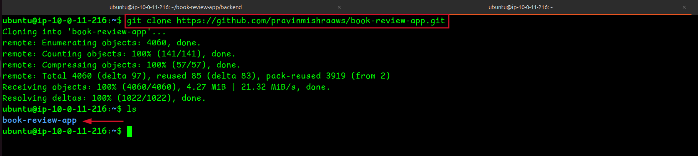

`bookreview-npm-ci.png`

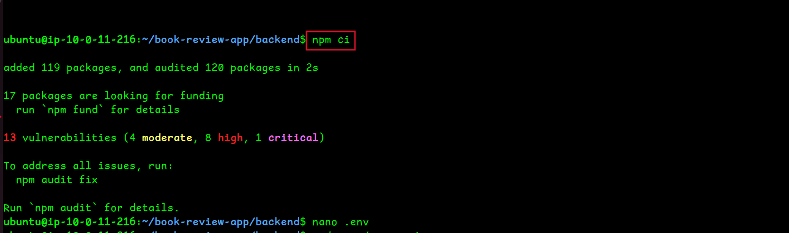

`bookreview-env-file.png`

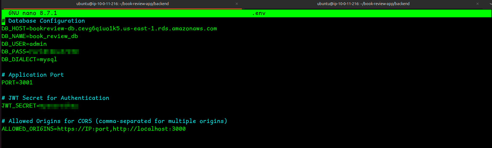

`bookreview-backend-foreground.png`

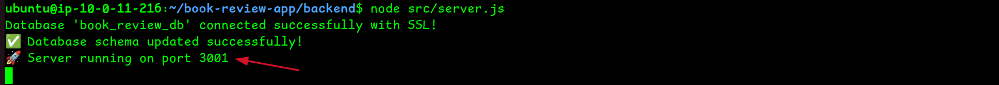

`bookreview-health-check.png` 

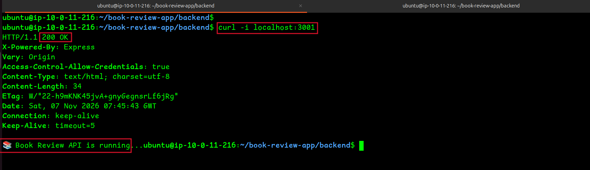

`bookreview-api-books.png`

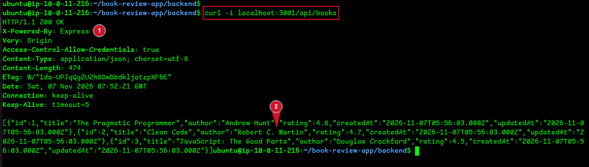

`bookreview-pm2-status.png`

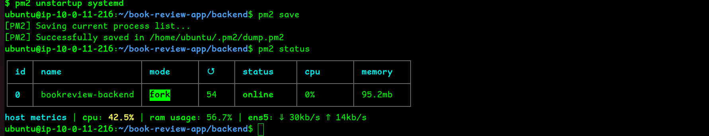

---

## Phase 10: Configure the Internal Application Load Balancer

### Objective

Create an internal Application Load Balancer to receive requests from the Web tier and distribute them to the private App EC2 instance running the Book Review backend.

### Step 1: Create the App Target Group

1. Open the **EC2 Console**.
2. Under **Load Balancing**, select **Target Groups**.
3. Click **Create target group**.
4. Configure the target group as follows:

| Setting | Value |
|:---|:---|
| Target type | Instances |
| Target group name | `bookreview-app-tg` |
| Protocol | HTTP |
| Port | 3001 |
| VPC | `bookreview-vpc` |
| Protocol version | HTTP1 |

5. Under **Health checks**, configure:
   - Health check protocol: HTTP
   - Health check path: `/`
   - Port: Traffic port
6. Leave the remaining settings at their defaults unless a change is required.
7. Click **Next**.

### Step 2: Register the App EC2 Instance

1. Under **Available instances**, locate `bookreview-app`.
2. Select the App EC2 instance.
3. Confirm that the traffic port is **3001**.
4. Click **Include as pending below**.
5. Review the registered target and click **Create target group**.

The target group is now configured to forward requests to the backend application running on port 3001.

### Step 3: Create the Internal Application Load Balancer

1. In the EC2 Console, select **Load Balancers** under **Load Balancing**.
2. Click **Create load balancer**.
3. Select **Application Load Balancer**.
4. Configure the basic settings:

| Setting | Value |
|:---|:---|
| Load balancer name | `bookreview-internal-alb` |
| Scheme | Internal |
| IP address type | IPv4 |
| VPC | `bookreview-vpc` |

5. Under **Network mapping**, select the two existing private App subnets:
   - `bookreview-app-a` : `us-east-1a`
   - `bookreview-app-b` : `us-east-1b`

6. Under **Security groups**, select `bookreview-alb-internal-sg`.
7. Remove any default security group if it was automatically selected and is not required.

### Step 4: Configure the Listener and Routing

1. Under **Listeners and routing**, configure the listener:
   - Protocol: HTTP
   - Port: 3001
2. For the default action, select **Forward to target groups**.
3. Choose `bookreview-app-tg`.
4. Review the listener configuration.

The internal ALB will receive requests from the Web tier on port 3001 and forward them to the registered App EC2 instance on port 3001.

5. Click **Create load balancer**.


### Step 5: Verify the Load Balancer and Target Health

1. Open **Load Balancers** and select `bookreview-internal-alb`.
2. Wait until its state changes to **Active**.
3. Open the **Listeners and rules** tab and confirm that the HTTP listener on port 3001 forwards traffic to `bookreview-app-tg`.
4. Open **Target Groups** and select `bookreview-app-tg`.
5. Open the **Targets** tab.
6. Confirm that `bookreview-app` is registered and its health status changes to **Healthy**.
7. Return to the load balancer details and copy its **DNS name**. This is the internal ALB endpoint that the Web tier will use to reach the backend API.

If the target remains unhealthy, check the target health reason, the backend application's PM2 status and the inbound security group rules. The App security group must allow port 3001 from `bookreview-alb-internal-sg`.

### Expected Result

The internal Application Load Balancer is active, its HTTP listener on port 3001 forwards requests to `bookreview-app-tg`, and the registered App EC2 instance reports a **Healthy** status. The internal ALB DNS name is available for the Web tier to use when communicating with the backend.

**Evidence:**

`bookreview-app-tg.png`

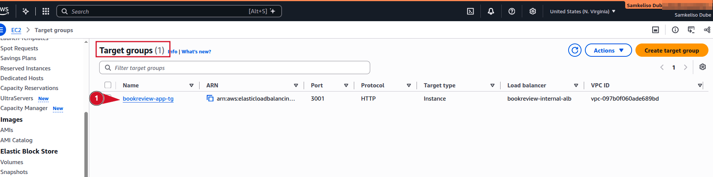

`bookreview-internal-alb.png`

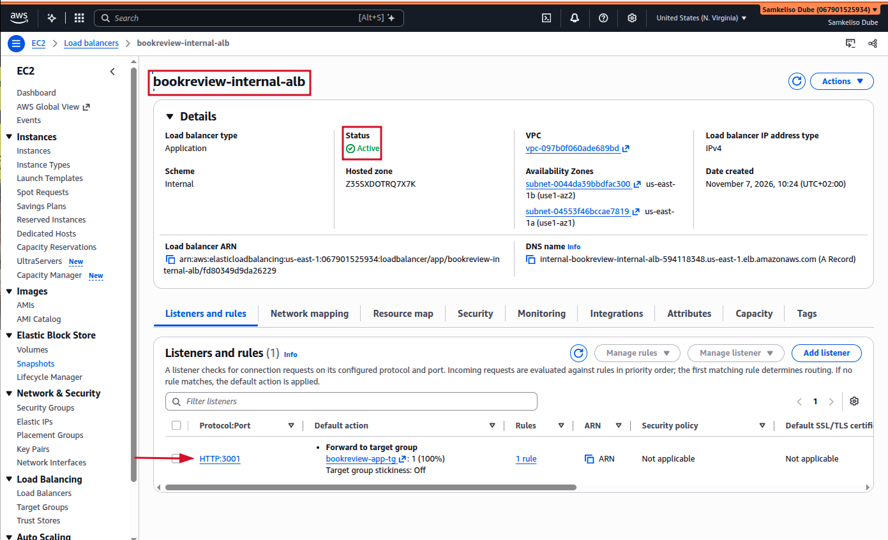

`bookreview-app-healthy.png`

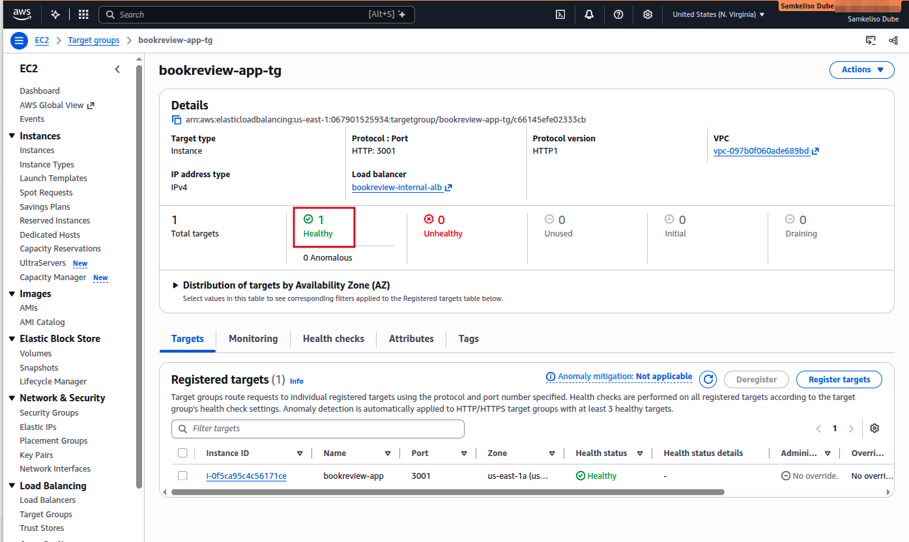

---

### Phase 11: Launch the Web EC2 and deploy Next.js and Nginx

**Objectives:** The objective of this phase is to launch the Web EC2 instance in the existing public Web subnet, connect to it securely through the Bastion Host using its private IP address, and deploy the Next.js frontend with Nginx.

**Steps:**

1. Add an inbound rule to `bookreview-web-sg`:
   - Type: SSH
   - Port: `22`
   - Source: `bookreview-bastion-sg`

2. Launch the EC2 instance with the following configuration:

   | Setting | Value |
   |---|---|
   | Name | `bookreview-web` |
   | AMI | Ubuntu Server 24.04 LTS |
   | Instance type | `t3.micro` |
   | Key pair | `bookreview-key` |
   | VPC | `bookreview-vpc` |
   | Subnet | `bookreview-web-a` (`us-east-1a`) |
   | Auto-assign public IP | Disable |
   | Security group | `bookreview-web-sg` |

3. Wait until the instance shows **Running** and passes its status checks. Record its private IP address.

4. From your local computer, connect to the Web instance through the Bastion Host using the same SSH ProxyCommand approach used in Phase 9. Replace the private IP with the Web instance's private IP:

   ```bash
   ssh -i <KEY_PATH>/bookreview-key.pem \
     -o IdentitiesOnly=yes \
     -o 'ProxyCommand=ssh -i <KEY_PATH>/bookreview-key.pem -o IdentitiesOnly=yes -W %h:%p ubuntu@<BASTION_PUBLIC_IP>' \
     ubuntu@<WEB_PRIVATE_IP>
   ```

5. Confirm the connection:

   ```bash
   hostname -I
   ```

   Confirm that the output contains the Web instance's private IP address.

6. Update the package list and install the required tools:

   ```bash
   sudo apt update
   sudo apt install -y git nginx nodejs npm
   ```

7. Clone the upstream repository and check out the pinned commit recorded in Phase 1:

   ```bash
   git clone https://github.com/pravinmishraaws/book-review-app.git
   cd book-review-app
   ```

8. Inspect the frontend API configuration:

   ```bash
   sed -n '1,20p' src/services/api.js
   ```

9. Configure the frontend production environment:

   ```bash
   cd frontend
   echo "NEXT_PUBLIC_API_URL=" > .env.production
   ```

10. Install dependencies and build the frontend:

    ```bash
    npm ci
    npm run build
    ```

    Record the `npm audit` summary in the Deployment Log. Do not run `npm audit fix --force`.

11. Install PM2 and start the frontend:

    ```bash
    sudo npm install -g pm2
    PORT=3000 pm2 start npm --name bookreview-frontend -- run start
    pm2 startup
    ```

    Run the exact startup command printed by PM2, then save the process list:

    ```bash
    pm2 save
    ```

12. Verify the frontend:

    ```bash
    pm2 status
    curl -I http://127.0.0.1:3000/
    ```

13. Configure Nginx in `/etc/nginx/sites-available/bookreview`:
    - `/` proxies requests to `http://127.0.0.1:3000`.
    - `/api/` proxies requests to the internal ALB on port `3001`, using the internal ALB DNS name recorded in Phase 10.

    ```nginx
    server {
        listen 80;
        server_name _;

        location / {
            proxy_pass http://127.0.0.1:3000;
            proxy_set_header Host $host;
            proxy_set_header X-Real-IP $remote_addr;
            proxy_set_header X-Forwarded-For $proxy_add_x_forwarded_for;
            proxy_set_header X-Forwarded-Proto $scheme;
        }

        location /api/ {
            proxy_pass http://<INTERNAL_ALB_DNS>:3001;
            proxy_set_header Host $host;
            proxy_set_header X-Real-IP $remote_addr;
            proxy_set_header X-Forwarded-For $proxy_add_x_forwarded_for;
            proxy_set_header X-Forwarded-Proto $scheme;
        }
    }
    ```

14. Enable the Nginx configuration and disable the default site:

    ```bash
    sudo ln -sf /etc/nginx/sites-available/bookreview /etc/nginx/sites-enabled/bookreview
    sudo rm -f /etc/nginx/sites-enabled/default
    sudo nginx -t
    ```

    Proceed only when Nginx reports `syntax is ok` and `test is successful`.

    Reload Nginx:

    ```bash
    sudo systemctl reload nginx
    ```

15. Test both application paths from the Web instance:

    ```bash
    curl -I http://127.0.0.1/
    curl -i http://127.0.0.1/api/books
    ```

**Expected result:** The frontend responds through Nginx on port 80, `/api/books` returns the backend's response through the internal ALB, and PM2 manages the frontend on port 3000.

**Evidence:**

`bookreview-web-instance-private-ip.png`

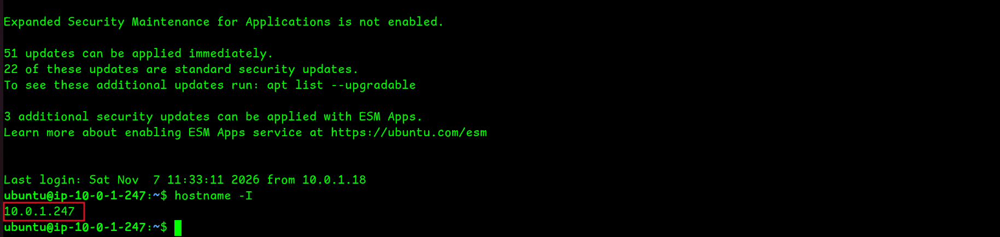

`bookreview-nginx-config.png`

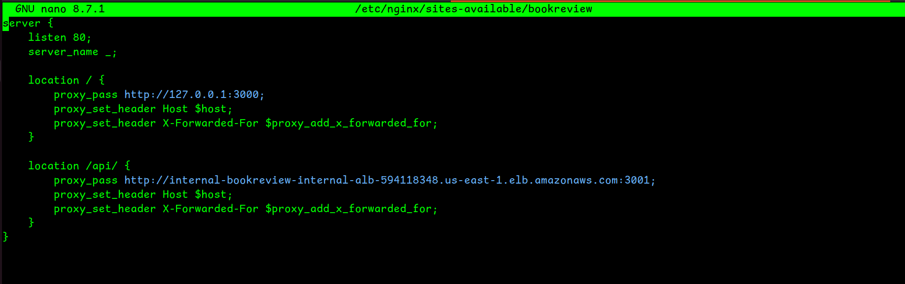

`bookreview-nginx-config-test-success.png`

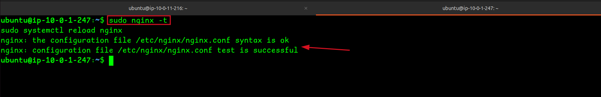

`bookreview-curl-test.png`

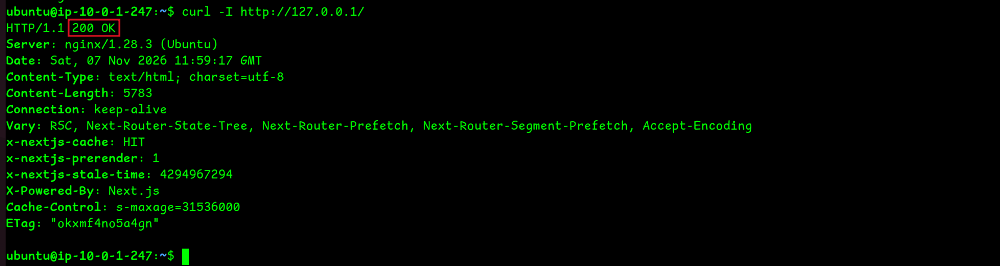

---

## Phase 12: Configure the Public Application Load Balancer

### Objective

Create a public Application Load Balancer (ALB) to receive incoming HTTP traffic and distribute requests to the Web EC2 instance running the Book Review frontend.

### Step 1: Create the Web Target Group

1. Open the **EC2 Console**.
2. Under **Load Balancing**, select **Target Groups**.
3. Click **Create target group**.
4. Configure the target group as follows:

   | Setting | Value |
   |---|---|
   | Target type | Instances |
   | Target group name | `bookreview-web-tg` |
   | Protocol | HTTP |
   | Port | 80 |
   | VPC | `bookreview-vpc` |
   | Protocol version | HTTP1 |

5. Under **Health checks**, configure:
   - Health check protocol: HTTP
   - Health check path: `/`
   - Port: Traffic port

6. Leave the remaining settings at their defaults unless a change is required.
7. Click **Next**.

### Step 2: Register the Web EC2 Instance

1. Under **Available instances**, locate `bookreview-web`.
2. Select the Web EC2 instance.
3. Confirm that the traffic port is **80**.
4. Click **Include as pending below**.
5. Review the registered target and click **Create target group**.

The target group is now configured to send traffic to the Web instance through Nginx on port 80.

### Step 3: Create the Public Application Load Balancer

1. In the EC2 Console, select **Load Balancers** under **Load Balancing**.
2. Click **Create load balancer**.
3. Select **Application Load Balancer**.
4. Configure the basic settings:

   | Setting | Value |
   |---|---|
   | Load balancer name | `bookreview-public-alb` |
   | Scheme | Internet-facing |
   | IP address type | IPv4 |
   | VPC | `bookreview-vpc` |

5. Under **Network mapping**, select the two existing public Web subnets:
   - `bookreview-web-a` : `us-east-1a`
   - `bookreview-web-b` : `us-east-1b`

6. Under **Security groups**, select `bookreview-alb-public-sg`.
7. Remove any default security group if it was automatically selected and is not required.


### Step 4: Configure the Listener and Routing

1. Under **Listeners and routing**, configure the listener:
   - Protocol: HTTP
   - Port: 80

2. For the default action, select **Forward to target groups**.
3. Choose `bookreview-web-tg`.
4. Review the listener configuration.

The public ALB will receive HTTP requests on port 80 and forward them to the registered Web EC2 instance on port 80.

5. Click **Create load balancer**.

### Step 5: Verify the Load Balancer and Target Health

1. Open **Load Balancers** and select `bookreview-public-alb`.
2. Wait until its state changes to **Active**.
3. Open the **Listeners and rules** tab and confirm that the HTTP listener on port 80 forwards traffic to `bookreview-web-tg`.
4. Open **Target Groups** and select `bookreview-web-tg`.
5. Open the **Targets** tab.
6. Confirm that `bookreview-web` is registered and its health status changes to **Healthy**.
7. Return to the load balancer details and copy its **DNS name** for the end-to-end test in Phase 13.

**Note:** If the target remains unhealthy, check the target health reason, the Web instance's Nginx service, and the inbound HTTP rule on `bookreview-web-sg`. The Web security group must allow port 80 from `bookreview-alb-public-sg`.

### Expected Result

The public Application Load Balancer is active, its HTTP listener forwards requests to `bookreview-web-tg`, and the registered Web EC2 instance reports a **Healthy** status. The ALB DNS name is available for testing the Book Review application in Phase 13.

**Evidence:**

`bookreview-e2e-frontend.png`

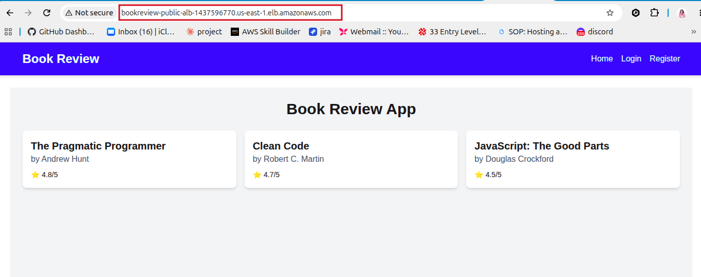

`bookreview-e2e-review.png`

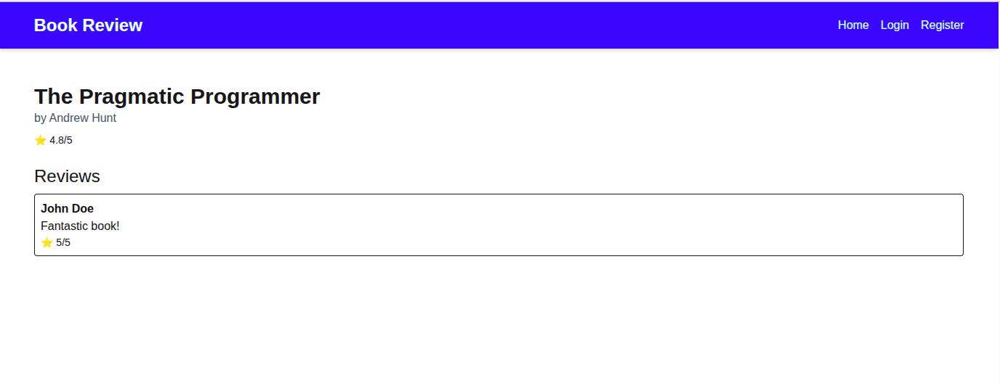

---

## 9. Validation and Acceptance Criteria

Perform the following tests after completing the manual deployment phases. Record the actual result of each test. Do not mark a test as Passed until it has been executed successfully.

| # | Test | Expected result | Result |
|---|---|---|---|
| 1 | Open `http://<PUBLIC_ALB_DNS>/` in a browser. | The Book Review homepage loads successfully through the public ALB. | Done |
| 2 | Request `/api/books` through the public ALB. | The API returns a successful HTTP response containing the expected JSON book data. | Done |
| 3 | Register a new test user. | User registration completes successfully. | Done |
| 4 | Log in using the registered user. | Authentication succeeds and the application displays the logged-in user's details. | Done|
| 5 | Open a book and view its reviews. | Book details and associated reviews load successfully. | Done |
| 6 | Submit a review while logged in. | The review is saved and displayed in the application. | Done |
| 7 | Check the public ALB target group `bookreview-web-tg`. | The Web EC2 instance is registered and reports Healthy. | Done |
| 8 | Check the internal ALB target group `bookreview-app-tg`. | The App EC2 instance is registered and reports Healthy. |Done|
| 9 | Check the backend through the internal ALB. | The backend responds successfully through the internal ALB on port `3001`. | Done |
| 10 | Verify App-to-RDS connectivity. | The backend successfully connects to the RDS MySQL database and retrieves application data. | Done |
| 11 | Verify App and Database public exposure. | The App EC2 instance and RDS database are not publicly accessible. | Done |
| 12 | Review the security group configurations. | Only the intended tier-to-tier communication and administrative access are permitted. | Done |

**Acceptance criteria:** The deployment is accepted when all required tests pass, the application works through the public ALB, and the evidence listed in Section 10 has been captured.

Record failures, their causes and their resolutions in the Troubleshooting Log (Section 12).


---

## 10. Troubleshooting Log

This section records issues encountered during the manual deployment, the evidence checked, identified root causes, corrective actions and retest results. These records provide a reference for diagnosing similar issues in future deployments.


### T01 : Read Replica Creation Disabled

**Date:** 2026-11-06  
**Phase:** Phase 6 : RDS Deployment

**Issue:**

The **Create read replica** option was greyed out in the Amazon RDS console, even though the primary database instance was available and configured for Multi-AZ deployment.

**Investigation:**

- Confirmed that `bookreview-db` was in the Available state.
- Confirmed that the database engine was MySQL Community.
- Confirmed that Multi-AZ was enabled.
- Checked the backup retention setting and found it was configured to 0 days.

**Root Cause:**

Automated backups were disabled because the backup retention period was set to 0 days. RDS requires automated backups to be enabled before a read replica can be created.

**Resolution:**

1. Opened the `bookreview-db` instance in the Amazon RDS console.
2. Selected **Modify**.
3. Changed the backup retention period from 0 days to 1 day.
4. Applied the modification immediately.
5. Checked the database actions again and confirmed that the read replica creation option was available.

**Retest:**

Pending confirmation that `bookreview-db-replica` was successfully created and reached Available status.

**Lesson Learned:**

Configure a backup retention period of at least 1 day when creating the primary RDS instance in Phase 6. Do not leave automated backups disabled if a read replica is required.

**Evidence:**

The screenshot below shows the RDS backup retention configuration encountered during troubleshooting.

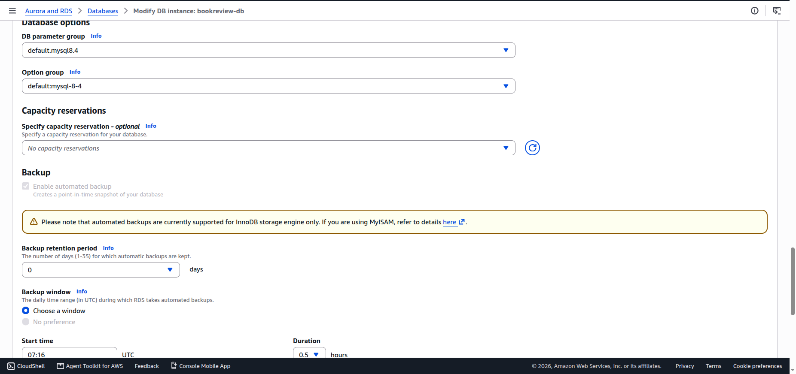

### T02 : Bastion SSH Connection Timeout

**Date:** 2026-11-06  
**Phase:** Phase 7 : Bastion Host Deployment

**Issue:**

SSH connection attempts to the Bastion host timed out, preventing remote access to the instance.

**Investigation:**

- Checked the inbound rules of `bookreview-bastion-sg`.
- Identified that the SSH rule was restricted to the previous public IP address.
- Confirmed that the laptop's public IP address had changed.

**Root Cause:**

The security group allowed SSH traffic only from the previous public IP address. Since the public IP had changed, incoming SSH connections from the laptop were blocked.

**Resolution:**

1. Identified the laptop's current public IP address.
2. Opened `bookreview-bastion-sg` in the AWS console.
3. Updated the inbound SSH rule on port 22.
4. Replaced the outdated source IP with the current public IP using `/32`.
5. Saved the updated security group rule.

**Retest:**

Successfully established an SSH connection to the Bastion host after updating the inbound rule.

**Lesson Learned:**

When SSH connections time out, verify the security group's inbound rules and confirm that the allowed source IP matches the current public IP address.

**Evidence:**

The screenshot below shows the Bastion SSH connection error encountered during troubleshooting.

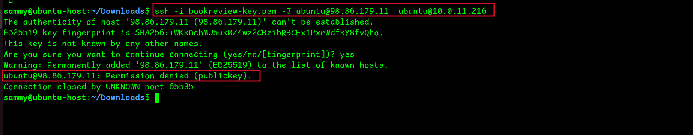

---

### T03 : SSH Private Key Permissions Rejected

**Date:** 2026-11-06  
**Phase:** Phase 7 : Bastion Host Deployment

**Issue:**

SSH refused to use the private key file when attempting to connect to the Bastion host.

**Investigation:**

1. Checked the private key file permissions using `ls -la bookreview-key.pem`.
2. Found that the file permissions were `-rw-rw-r--`.
3. Identified that the private key was readable by other users.

**Root Cause:**

SSH requires private key files to have restricted permissions. The existing permissions allowed other users to read the key, so SSH rejected it.

**Resolution:**

Ran the following command to restrict access to the private key:

```bash
chmod 400 bookreview-key.pem
```

**Retest:**

Successfully established the SSH connection after correcting the private key permissions.

**Lesson Learned:**

Always restrict private key permissions before using SSH. Use `chmod 400` to ensure that only the file owner can read the key.

---

### T04 : Backend Restart Loop Caused by Too Many Database Keys

**Date:** 2026-11-07  
**Phase:** Phase 9 : Backend Deployment

**Issue:**

The backend repeatedly restarted under PM2 and failed during database initialization. The MySQL error reported was `ER_TOO_MANY_KEYS`.

**Investigation:**

1. Checked the backend process using PM2.
2. Found that `bookreview-backend` was online but had accumulated 245 restarts.
3. Inspected the backend logs and identified the error occurring during `ALTER TABLE Users`.
4. Inspected the `Users` table and found 63 unique indexes associated with the email column, including `email`, `email_2` through `email_63`.
5. Reviewed `backend/src/server.js` and identified that Sequelize was using `sync({ alter: true })`.

**Root Cause:**

The Sequelize `sync({ alter: true })` configuration was repeatedly modifying the database schema during backend startup. This created additional unique indexes on the email column until MySQL reached its limit of 64 keys per table.

**Resolution:**

1. Stopped the backend process using PM2.
2. Inspected the existing indexes on the `Users` table.
3. Removed the duplicate email indexes from `email_2` through `email_63`, keeping the original `email` index.
4. Updated the synchronization configuration for the User, Book and Review models from `sync({ alter: true })` to `sync()`.
5. Restarted the backend using PM2.

**Retest:**

Confirmed that only the original email index remained. The backend started successfully, and the `/api/books` endpoint returned HTTP 200.

**Lesson Learned:**

Avoid using `sync({ alter: true })` during repeated application startups against a persistent database. Database schema changes should be managed carefully to prevent duplicate indexes and unexpected database errors.

**Evidence:**

The screenshot below shows the database key error encountered during backend troubleshooting.

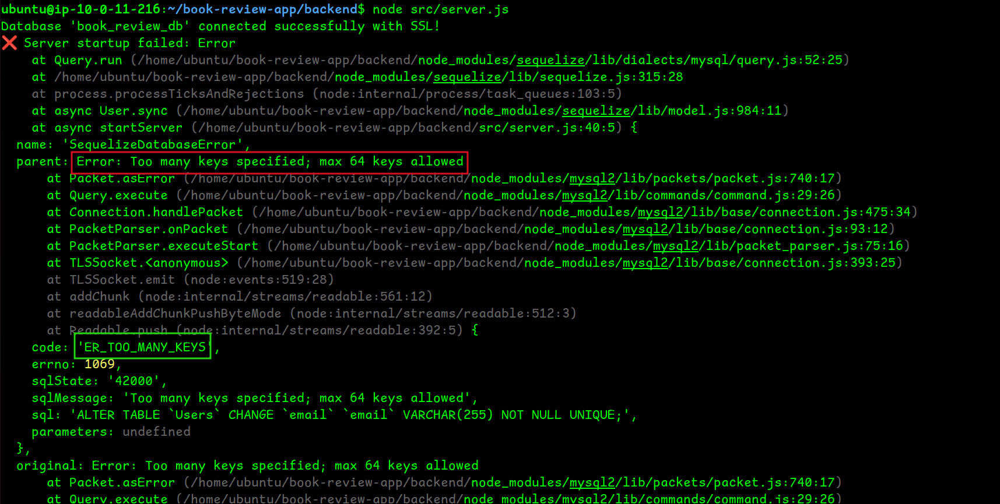
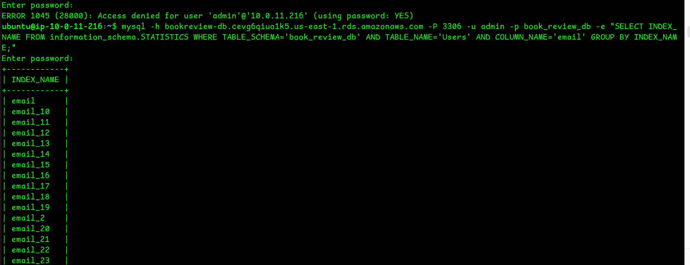

---

### T05 : Database Password Placeholder Caused Access Denied Error

**Date:** 2026-11-07  
**Phase:** Phase 9 : Backend Deployment

**Issue:**

The database index-cleanup command failed with an Access denied error when connecting to MySQL using the application database account.

**Investigation:**

- Reviewed the command used to execute the database index-cleanup loop.
- Found that the literal `<MASTER_PASSWORD>` had been supplied instead of the actual password.
- Confirmed that MySQL rejected the authentication attempt.

**Root Cause:**

The password placeholder had not been replaced with the actual database password before executing the command.

**Resolution:**

1. Stored the database password in a temporary MySQL option file.
2. Restricted access to the temporary file using `chmod 600`.
3. Re-ran the index-cleanup loop without exposing the password directly in the command.
4. Removed the temporary option file after completing the operation.

**Retest:**

The index-cleanup loop completed successfully, and a subsequent database query confirmed that only the original email index remained.

**Lesson Learned:**

Always replace command placeholders with the correct values before execution. Avoid placing database passwords directly in shell commands because they may be exposed through shell history or process information.

**Evidence:**

The screenshot below shows the database password error encountered during troubleshooting.

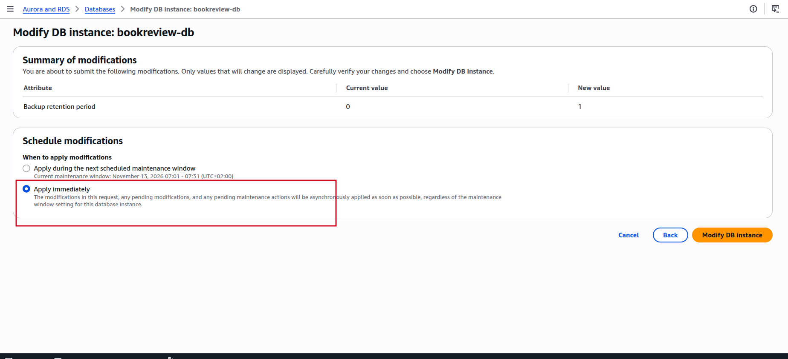

---
### T06 : Backend Started From the Wrong Directory

**Date:** 2026-11-07  
**Phase:** Phase 9 : Backend Deployment

**Issue:**

The backend failed to connect to the database and returned the error:

`Database initialization failed: connect ECONNREFUSED 127.0.0.1:3306`

**Investigation:**

1. Reviewed the command used to start the backend.
2. Found that the application had been started from the home directory using:

   ```bash
   node book-review-app/backend/src/server.js
   ```

3. Identified that the backend's `.env` file was located inside the backend directory.
4. Confirmed that the application was falling back to `127.0.0.1` because the expected database configuration was not being loaded from the current working directory.

**Root Cause:**

The backend was started from the wrong working directory. The environment configuration was therefore not loaded as expected, causing the application to attempt a connection to the local MySQL instance.

**Resolution:**

1. Changed into the backend directory:

   ```bash
   cd ~/book-review-app/backend
   ```

2. Started the application from the correct location:

   ```bash
   node src/server.js
   ```

**Retest:**

The backend successfully loaded its environment configuration and connected to the RDS database.

**Lesson Learned:**

Start the backend from its correct application directory when using environment files loaded relative to the current working directory. Always verify the working directory before starting the application.

---

### T07 : Book Details Page Stuck on Loading

**Date:** 2026-11-07  
**Phase:** Phase 11–12 : Web Application and Public Access Deployment

**Issue:**

The Book Review frontend displayed `Loading book details...` and did not load the selected book's information.

**Investigation:**

1. Opened the browser Developer Tools.
2. Inspected the Network tab to identify the request responsible for loading the book details.
3. Found that the affected request returned an error.
4. Confirmed that the backend `/api/books` endpoint returned HTTP 200 through Nginx.
5. Reviewed `src/services/api.js` and identified that the API URLs were being constructed from `NEXT_PUBLIC_API_URL` without the required `/api` prefix.

**Root Cause:**

The frontend API URL configuration did not match the backend route structure. The backend routes were registered under `/api/`, but the frontend was constructing requests without that prefix.

**Resolution:**

Pending. Update the API base URL in `src/services/api.js` to include the `/api` prefix, or correct the affected book-detail request to use the appropriate `/api/books/<id>` endpoint. Rebuild and restart the frontend after making the correction.

**Retest:**

Pending confirmation that the book details request succeeds and the selected book information loads correctly in the browser.

**Lesson Learned:**

When a frontend page remains stuck loading, inspect the complete request URL and HTTP response in the browser Network tab. Confirm that frontend API paths match the routes exposed by the backend.

**Evidence:**

The screenshot below shows the book details loading issue encountered during browser testing.

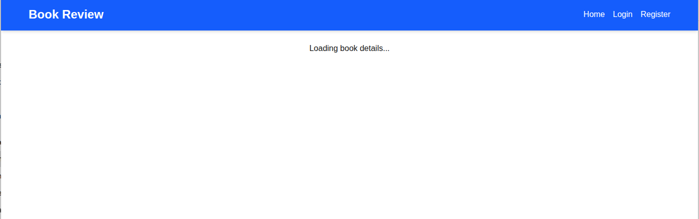

---

## 11. Teardown Procedure

Only begin teardown after deployment, testing and evidence collection are complete.

1. Delete the public ALB and internal ALB.
2. Delete their target groups.
3. Terminate the Web and App EC2 instances.
4. Delete any read replicas first, then the primary RDS database according to the approved snapshot decision.
5. Delete any NAT Gateway if one was created; confirm its Elastic IP is released.
6. Delete launch templates if any were created.
7. Delete security groups after dependencies are removed.
8. Delete non-default route tables after disassociating subnets.
9. Delete the subnets.
10. Detach and delete the Internet Gateway.
11. Delete the VPC.
12. Review AWS billing and cost views for remaining resources.

Record the teardown date and capture evidence. Deleting resources does not remove charges already incurred.

---

## Book Review on AWS: Manual Deployment Summary

**Status:** Complete

The Book Review application was manually deployed on AWS in the `us-east-1` region using a three-tier architecture. A public Application Load Balancer and Nginx serve the Next.js frontend on the Web tier. An internal Application Load Balancer routes API requests to the Express backend running on a private App EC2 instance. Amazon RDS for MySQL runs in private database subnets, configured with Multi-AZ deployment and a read replica.

The application was successfully accessed through the public ALB, with book data retrieved from RDS. Private instances were accessed through a bastion host using SSH ProxyCommand, while the private key remained on the local machine.

Nine deployment issues were encountered and resolved. Their causes and resolutions are documented in the Troubleshooting Log.

**Known limitations:** The backend uses the RDS master account as a lab simplification, the frontend has outstanding npm audit findings, and HTTPS was outside the scope of this deployment.

All AWS resources were deleted after evidence collection, following the order documented in the teardown checklist.

**Next step:** Automate the same architecture using Terraform for infrastructure provisioning and Ansible for server configuration.
