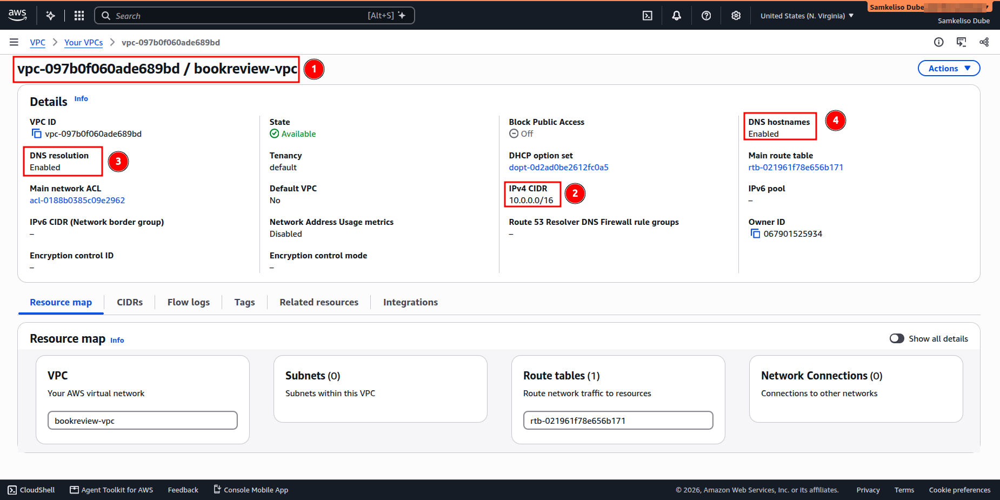
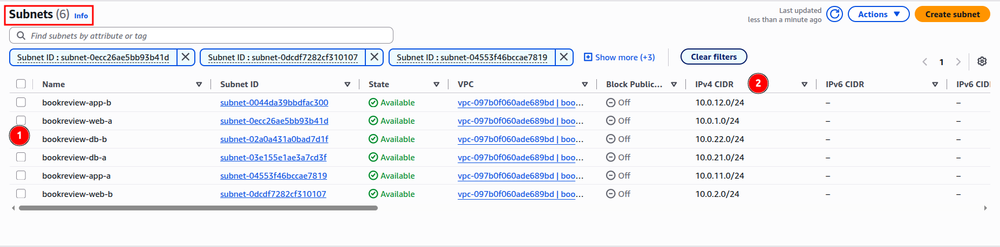
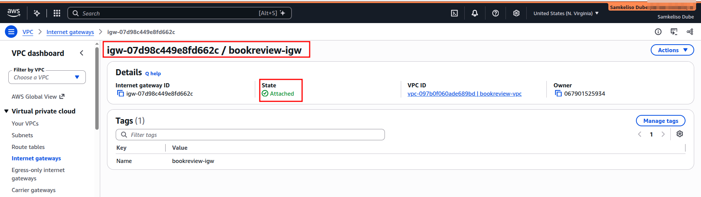
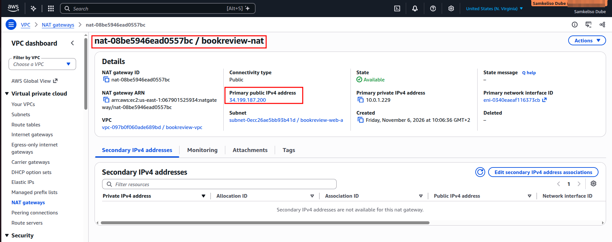
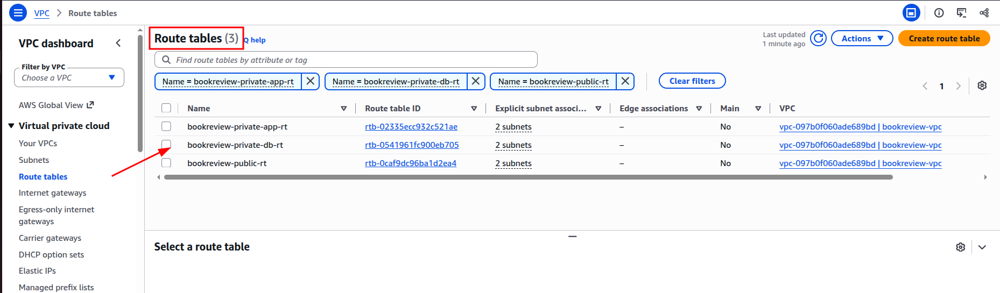
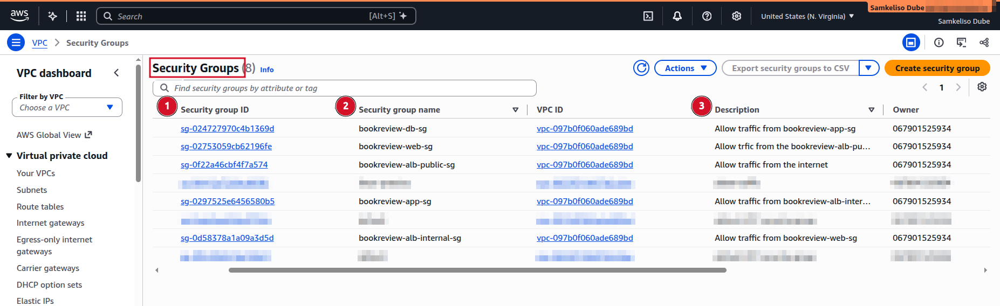
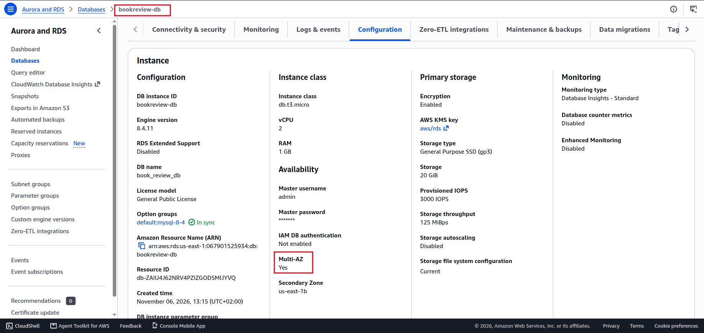
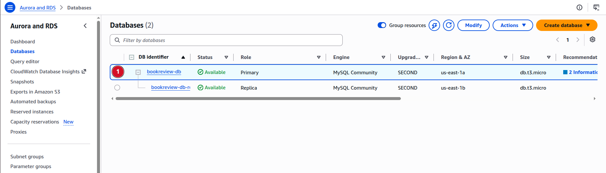
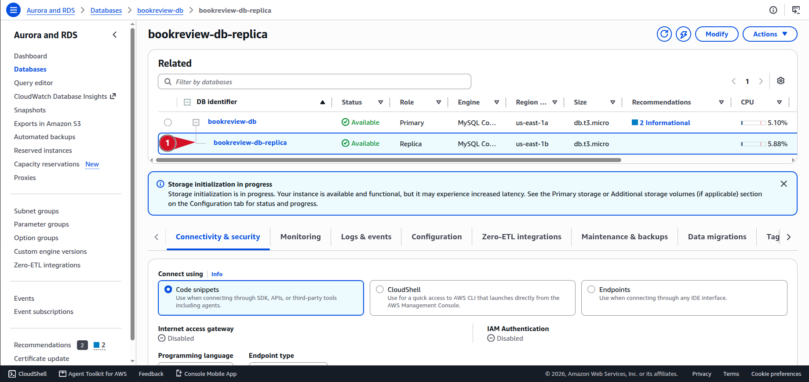

# 📚 Three-Tier Architecture: Book Review Application Manual Deployment on AWS

**Document status:** Draft : Deployment in Progress  
**Deployment method:** AWS Management Console and CLI  
**Architecture:** Three-tier (Web, App, Database)  
**Database:** Amazon RDS for MySQL, Multi-AZ with read replica  
**Prepared by:** Samkeliso Dube  
**AWS Region:** `us-east-1`  
**Upstream source:** `pravinmishraaws/book-review-app`  
**Deployment type:** Manual

---

## Table of Contents

1. [Purpose](#1-purpose)
2. [Scope](#2-scope)
3. [Application Architecture](#3-application-architecture)
4. [Confirmed Source Code Details](#4-confirmed-source-code-details)
5. [Network Design](#5-network-design)
6. [Deployment Design](#6-deployment-design)
7. [Manual AWS Infrastructure Deployment](#7-manual-aws-infrastructure-deployment)
8. [Application Deployment](#8-application-deployment)
9. [Validation and Acceptance Criteria](#9-validation-and-acceptance-criteria)
10. [Evidence Checklist](#10-evidence-checklist)
11. [Teardown Procedure](#11-teardown-procedure)
12. [Deployment Log](#12-deployment-log)
13. [Troubleshooting Log](#13-troubleshooting-log)
14. [AWS Resource Register](#14-aws-resource-register)
15. [Time Record](#15-time-record)

---

## 1. Purpose

This document provides the step-by-step procedure for manually deploying the Book Review application on AWS. It records the infrastructure configuration, application deployment, validation, troubleshooting, and evidence collection for the three-tier architecture (Web, App, and Database), using a public Application Load Balancer, an internal Application Load Balancer, and Amazon RDS for MySQL with Multi-AZ and a read replica.

The steps are written as they are performed, and the commands and values reflect the final working configuration. Issues encountered during deployment are recorded in Section 13, Troubleshooting Log.

Each deployment phase is completed and verified before moving to the next phase.

## 2. Scope

This deployment includes:

- Amazon VPC and subnet configuration across two Availability Zones.
- Internet Gateway, NAT Gateway, and route tables.
- Security groups for each tier.
- Public Application Load Balancer.
- Web EC2 instance running Ubuntu, Nginx, and Next.js.
- Internal Application Load Balancer.
- Private App EC2 instance running Node.js and Express.
- Amazon RDS for MySQL with Multi-AZ and a read replica.
- Application configuration and testing.
- Deployment evidence and final teardown.

Terraform, Ansible, Docker, Kubernetes, and CI/CD are reserved for later project phases.

## 3. Application Architecture

### 3.1 Application Components

| Tier | Component | Port | Reachable from | Responsibility |
|---|---|---:|---|---|
| Web | Nginx | 80 | Public ALB | Receives HTTP requests, serves the frontend, and proxies `/api/` requests to the internal ALB |
| Web | Next.js | 3000 | Nginx on the same instance only | Serves the user interface |
| App | Node.js and Express | 3001 | Internal ALB | Application API (`/api/users`, `/api/books`, `/api/reviews`), with Sequelize as the database access layer |
| Database | MySQL on RDS | 3306 | App tier only | Persistent data storage, Multi-AZ with read replica |

### 3.2 Request Flow

```
Browser
  → Public ALB (port 80)
    → Nginx on Web EC2 (port 80)
      → Next.js (port 3000) for frontend pages
      → Internal ALB (port 3001) for API requests
        → Express on App EC2 (port 3001)
          → RDS MySQL (port 3306)
```

### 3.2 Traffic flow

The following diagram illustrates how requests travel
through the three-tier application architecture.


**Important:** The browser must not access the private internal ALB directly. Nginx will proxy `/api/*` requests to the internal ALB. We will verify this against the frontend source before configuring the production build.

## 4. Confirmed Source Code Details

| Item | Finding |
|---|---|
| Frontend framework | Next.js `15.2.3` |
| Frontend runtime | React `^19.0.0` |
| Frontend build | `npm run build` |
| Frontend production start | `npm run start` |
| Backend framework | Express 4 |
| Backend entry point | `backend/src/server.js` |
| Backend port | `3001` |
| Database library | Sequelize and MySQL2 |
| Database name | `book_review_db` |
| Database port | `3306` |
| Backend health endpoint | `GET /` returns an API-running message |
| API routes | `/api/users`, `/api/books`, `/api/reviews` |

**Database warning:** The backend currently uses Sequelize `sync({ alter: true })` and may seed sample data during startup. Do not run against the RDS database until this behaviour is reviewed. The `alter: true` option can modify existing table structures, potentially changing or removing columns.

**Configuration warning:** The local `.env` file must not be copied unchanged to AWS. Use secure production credentials and the RDS endpoint.

## 5. Network Design

**VPC name:** `bookreview-vpc`
**VPC CIDR:** `10.0.0.0/16`
**DNS hostnames:** Enabled

| Component | Name | Configuration |
|---|---|---|
| VPC | `bookreview-vpc` | CIDR `10.0.0.0/16`, DNS resolution and DNS hostnames enabled |
| Subnets | See Section 5.1 | Two AZs, two subnets per tier |
| Internet Gateway | `bookreview-igw` | Attached to `bookreview-vpc` |
| NAT Gateway | `bookreview-nat` | Public, in `bookreview-web-a`, with an Elastic IP associated |
| Route tables | See Section 5.2 | One per tier |
| Security groups | See Section 5.3 | One per tier boundary |

### 5.1 Subnets

| Subnet | Name | CIDR | Availability Zone | Type |
|---|---|---|---|---|
| Web A | `bookreview-web-a` | `10.0.1.0/24` | `us-east-1a` | Public |
| Web B | `bookreview-web-b` | `10.0.2.0/24` | `us-east-1b` | Public |
| App A | `bookreview-app-a` | `10.0.11.0/24` | `us-east-1a` | Private |
| App B | `bookreview-app-b` | `10.0.12.0/24` | `us-east-1b` | Private |
| DB A | `bookreview-db-a` | `10.0.21.0/24` | `us-east-1a` | Private |
| DB B | `bookreview-db-b` | `10.0.22.0/24` | `us-east-1b` | Private |

Subnet ranges were checked against the course IP calculation sheet before creation. No ranges overlap within `10.0.0.0/16`.

### 5.2 Route Tables

| Route table | Associated subnets | Routes |
|---|---|---|
| `bookreview-public-rt` | Web A, Web B | `10.0.0.0/16` local, `0.0.0.0/0` to Internet Gateway |
| `bookreview-private-app-rt` | App A, App B | `10.0.0.0/16` local, `0.0.0.0/0` to NAT Gateway |
| `bookreview-private-db-rt` | DB A, DB B | `10.0.0.0/16` local only |

The DB route table has no internet route. The database does not need outbound internet access.

### 5.3 Security Groups

Create these security groups in `bookreview-vpc`. Outbound rules are left at the default (all traffic allowed).

| Security group | Inbound port | Source | Purpose |
|---|---:|---|---|
| `bookreview-alb-public-sg` | 80 | `0.0.0.0/0` | Internet to public ALB |
| `bookreview-web-sg` | 80 | `bookreview-alb-public-sg` | Public ALB to Nginx |
| `bookreview-alb-internal-sg` | 3001 | `bookreview-web-sg` | Nginx to internal ALB |
| `bookreview-app-sg` | 3001 | `bookreview-alb-internal-sg` | Internal ALB to Express |
| `bookreview-db-sg` | 3306 | `bookreview-app-sg` | Express to RDS |

No security group allows port 22. Administrative access uses Session Manager, configured in Section 7.

## 6. Deployment Design

| Component | Decision |
|---|---|
| Architecture | Three-tier |
| Public entry point | Internet-facing ALB, port 80 |
| Web tier | Ubuntu EC2 in public subnets, Nginx and Next.js |
| App entry point | Internal ALB, port 3001 |
| App tier | Private Ubuntu EC2, Node.js and Express |
| Database | Private Amazon RDS for MySQL |
| RDS availability | Multi-AZ |
| Read replica | One, single-AZ, from the Multi-AZ primary |
| Auto Scaling Groups | Not used (single instance per tier) |
| Elastic IPs | None on instances. The NAT Gateway uses one internally. |
| NAT Gateway | Required for App tier outbound access (`npm install`, Git clone) |
| HTTPS | Out of scope for this deployment stage |
| Deployment method | Manual |

**Cost note:** Multi-AZ, the read replica, the NAT Gateway, and two ALBs all bill while running.

**Implementation note:** The NAT Gateway provides outbound internet access for private instances. It does not make the App EC2 instance publicly accessible.


**Design notes**

- The NAT Gateway serves both App subnets from one AZ. This is a cost-saving choice for this practice deployment, not a highly available design. If `bookreview-web-a` fails, the App tier loses outbound access. Traffic from App B also crosses AZs and can incur data transfer charges. A production design uses one NAT Gateway per AZ.
- The database route table has no internet route.
- 
## 7. Manual AWS Infrastructure Deployment

### Phase 1: Preparation

1. Confirm the AWS Region.
2. Confirm the source repository and commit to deploy.
3. Check the AWS budget alert.
4. Confirm the subnet CIDR plan.
5. Confirm the RDS Multi-AZ and read replica design in Section 6.
6. Confirm local environment files are excluded from Git.
7. Select cost-appropriate EC2 and RDS instance sizes.

**Evidence:**
- Repository and commit.
- AWS Region.
- Budget alert.
- Final network plan.

**Status:** Not started.

### Phase 2: Create the VPC

1. Sign in to the [AWS Management Console](https://aws.amazon.com/console/).
2. Search for `VPC` and open the VPC service.
3. Select **Your VPCs**, then select **Create VPC**.
4. Choose **VPC only**.
5. Enter the name `bookreview-vpc`.
6. Enter the IPv4 CIDR `10.0.0.0/16`.
7. Leave IPv6 as **No IPv6 CIDR block**, and tenancy as **Default**.
8. Select **Create VPC**.
9. Open `bookreview-vpc` from the VPC list.
10. Select **Actions → Edit VPC settings**.
11. Enable **DNS resolution** and **DNS hostnames**, then select **Save**.
12. Confirm both settings show as enabled on the VPC details page.

**Expected result:** The VPC is created with CIDR `10.0.0.0/16`, and DNS resolution and DNS hostnames are both enabled.

**Evidence:** `step01-vpc.png`



### Phase 3: Create the six subnets

1. Open **VPC → Subnets**.
2. Select **Create subnet**.
3. Select `bookreview-vpc`.
4. Create the six subnets:
   - `bookreview-web-a`, `10.0.1.0/24`, `us-east-1a`, public
   - `bookreview-web-b`, `10.0.2.0/24`, `us-east-1b`, public
   - `bookreview-app-a`, `10.0.11.0/24`, `us-east-1a`, private
   - `bookreview-app-b`, `10.0.12.0/24`, `us-east-1b`, private
   - `bookreview-db-a`, `10.0.21.0/24`, `us-east-1a`, private
   - `bookreview-db-b`, `10.0.22.0/24`, `us-east-1b`, private
5. Verify the Availability Zone and CIDR range for each subnet.
6. Keep auto-assign public IPv4 disabled on all subnets, including the Web subnets. Web instances are reached only through the public ALB.

**Expected result:** Six subnets exist in `bookreview-vpc` with the correct Availability Zones and CIDR ranges.

**Evidence:** `step02-subnets.png`



### Phase 4: Internet Gateway, NAT Gateway, and route tables

1. Open **VPC → Internet Gateways**.
2. Create `bookreview-igw` and attach it to `bookreview-vpc`.
3. Open **VPC → Elastic IPs** and allocate an Elastic IP named `bookreview-nat-eip`.
4. Open **VPC → NAT Gateways** and select **Create NAT gateway**:
   - Name: `bookreview-nat`
   - Availability mode: **Zonal**
   - Subnet: `bookreview-web-a`
   - Connectivity type: **Public**
   - Elastic IP allocation ID: `bookreview-nat-eip`. Do not select **Allocate Elastic IP** on this form.
   - Leave **Additional settings** and **Tags** as they are, then select **Create NAT gateway**.
   - Wait until the NAT Gateway shows **Available**, then record its Elastic IP address in the resource register.
1. Open **VPC → Route Tables** and create `bookreview-public-rt`.
2. Add the route `0.0.0.0/0` pointing to `bookreview-igw`.
3. Associate `bookreview-web-a` and `bookreview-web-b` with `bookreview-public-rt`.
4. Create `bookreview-private-app-rt`.
9. Add the route `0.0.0.0/0` pointing to `bookreview-nat`.
10. Associate `bookreview-app-a` and `bookreview-app-b` with `bookreview-private-app-rt`.
11. Create `bookreview-private-db-rt`.
12. Associate `bookreview-db-a` and `bookreview-db-b` with `bookreview-private-db-rt`. Do not add any default route.

**Expected result:** Web subnets route to the Internet Gateway. App subnets route to the NAT Gateway. DB subnets have only the local VPC route.

**Evidence:**
- `step03-igw.png`
  

- `step04-nat-gateway.png`
  

- `step05-route-tables.png`
  


### Phase 5: Security groups

1. Open **EC2 → Security Groups**.
2. Create the five security groups listed in Section 5.3:
   - `bookreview-alb-public-sg`
   - `bookreview-web-sg`
   - `bookreview-alb-internal-sg`
   - `bookreview-app-sg`
   - `bookreview-db-sg`
3. Select `bookreview-vpc` for each group.
4. Configure the inbound rules exactly as listed in Section 5.3.
5. Use security group references, not IP addresses, for tier-to-tier rules.
6. Review all inbound rules.
7. Confirm only `bookreview-alb-public-sg` accepts traffic from `0.0.0.0/0`.

**Expected result:** Each tier only accepts the traffic it requires.

**Evidence:** `step06-security-groups.png`

 

### Phase 6: Create RDS for MySQL

**Pre-step: DB subnet group**

1. Open **RDS → Subnet groups** and select **Create DB subnet group**.
2. Name it `bookreview-db-subnets`.
3. Select `bookreview-vpc`.
4. Add `bookreview-db-a` (`us-east-1a`) and `bookreview-db-b` (`us-east-1b`).
5. Select **Create**.

**Create the database**

6. Open **RDS → Databases** and select **Create database**.

**Choose a database creation method**

7. Select **Full configuration**.

**Engine options**

8. Engine type: **MySQL**.

**Templates**

9. Select **Dev/Test** or leave the default. Do not select **Production**, since it sets defaults that cost more than this lab needs.

**Availability and durability**

10. Deployment option: **Multi-AZ DB instance deployment (2 instances)**. Do not select the 3-instance Multi-AZ DB cluster option.

**Settings**

11. Edition: **MySQL Community**.
12. Engine version: select the latest **MySQL 8.4** version offered. Leave **Enable RDS Extended Support** unchecked.
13. DB instance identifier: `bookreview-db`.

**Credentials settings**
14. Master username: `admin`.
15. Credentials management: **Self managed**.
16. Enter a strong master password and confirm it. RDS requires at least 8 printable characters and doesn't allow `/`, `"`, `@`, or spaces. Store the password in a password manager. Do not record it in this document or the repository.


**Instance configuration**

18. DB instance class: `db.t4g.micro`, a burstable class that fits a lab. If it isn't offered for your engine version, choose the smallest burstable class listed.

**Storage**

19. Storage type: **General Purpose SSD (gp3)**. Do not use Provisioned IOPS SSD (io2).
20. Allocated storage: `20` GiB, the minimum for gp3.
21. Expand **Additional storage configuration**. Leave storage autoscaling disabled.

**Connectivity**

22. Compute resource: **Don't connect to an EC2 compute resource**. The security groups in Section 5.3 are configured manually, so the console should not change them.
23. Virtual private cloud (VPC): select **`bookreview-vpc`**, not the default VPC.
24. DB subnet group: select **`bookreview-db-subnets`**.
25. Public access: **No**.
26. VPC security group: select **Choose existing**, then select **`bookreview-db-sg`**. Remove the `default` group.
27. Certificate authority: leave the default.

**Additional configuration**

28. Leave **Database options**, **Encryption**, and **Backup** at their defaults.
29. **Deletion protection:** this is turned on by default. Leave it on while the database is running, and turn it off in Phase 14 before teardown, or the delete will fail.

**Monitoring**

30. Database Insights: **Standard**. Advanced adds charges.
31. Enhanced Monitoring: leave **off** for this lab.
32. Log exports: leave all unchecked for this lab.

**Additional configuration**

33. Expand **Additional configuration**.
34. Initial database name: `book_review_db`. This matches the database name in the source code. If you leave it blank, RDS creates no database.
35. DB parameter group: leave `default.mysql8.4`.
39. Option group: leave `default:mysql-8-4`.
40. Encryption: leave **Enable encryption** on, with the KMS key `aws/rds (default)`.
41. Backup: leave **Enable automated backup** on. Set **Backup retention period** to `1` day to limit backup storage cost. The estimate excludes backup storage, so keep this short for the lab.
42. Backup window: leave **No preference**.
43. Backup replication: leave **Enable replication in another AWS Region** off.
44. Auto minor version upgrade: leave on.
45. Maintenance window: leave **No preference**.
46. Deletion protection: turn it **on**, as set in step 29. Turn it off in Phase 14 before deleting the database.

**Create the database**

34. Select **Create database**.
35. Wait until the status is **Available**. Multi-AZ provisioning can take 10 to 20 minutes.
36. Record the endpoint and port. Do not record credentials.
37. Create a dedicated application database user. Do not use the `admin` master account in the application.

**Create the read replica**

38. Select `bookreview-db`, then select **Actions → Create read replica**.
**Create the read replica**

44. Tick the checkbox next to `bookreview-db`, then select **Actions → Create read replica**. Do not select **Create Aurora read replica**.
45. Source DB instance identifier: `bookreview-db`. This is filled in automatically.
46. DB instance identifier: `bookreview-db-replica`.
47. DB instance class: **Burstable classes**, then `db.t3.micro`, the same as the source.
48. Destination Region: **US East (N. Virginia)**.
49. Storage type: **General Purpose SSD (gp3)**, with allocated storage `20` GiB, the same as the source.
50. Deployment option: **Single-AZ DB instance deployment (1 instance)**. The replica is a single copy, so Multi-AZ is not selected here.
51. DB subnet group: `bookreview-db-subnets`.
52. Public access: **Not publicly accessible**.
53. Existing VPC security groups: `bookreview-db-sg`.
54. Database authentication: **Password authentication**.
55. Monitoring: Database Insights **Standard**. Enhanced Monitoring stays off, and log exports stay unchecked.
56. Encryption: leave encryption on with the default KMS key. The replica must use the same encryption setting as the source. Select the default key from the list rather than entering an ARN.
57. Auto minor version upgrade: leave on.
58. Deletion protection: turn on. Turn it off in Phase 14 before teardown.
59. Tags: add `Name` = `bookreview-db-replica`.
60. Select **Create read replica**, then wait until the status is **Available**.
61. Confirm the **Region & AZ** column shows the replica in `us-east-1b`. If it's in another zone, record that in the Deployment Log. Either zone works, so it doesn't need to be recreated.

**Expected result:** `bookreview-db-replica` is Available, private, and in the same VPC as the primary.

**Evidence:**
- `step07-rds-configuration.png`
   
- `step08-rds-available.png`
   
- `step09-read-replica.png`
  


**Expected result:** The primary is Multi-AZ and Available, the read replica is Available, and both are private.

### Phase 7: Bastion access, key pair and SSH rules

**What we are doing:** We are creating the administrative path into the private App tier. This includes a key pair, a small jump host, and the SSH rules that connect them.

**Why we are doing it:** The App instance is in a private subnet with no public IP, so it can't be reached from the internet. The bastion is the only instance that accepts SSH from outside, and only from our IP. From the bastion, we SSH to the App instance over its private IP. This access is needed before the App is deployed in Phase 9.

**Access decision:** Option 1, bastion host. Session Manager is not used in this deployment.

**Steps:**

1. Open **EC2 → Key pairs** and create `bookreview-key` (RSA, `.pem`). Download the file and store it outside the repository.
2. Create the security group `bookreview-bastion-sg` in `bookreview-vpc`:
   - Inbound: port 22, source = your current public IP (`x.x.x.x/32`)
   - Outbound: default
3. Edit `bookreview-app-sg` and add an inbound rule: port 22, source = `bookreview-bastion-sg`.
4. Launch `bookreview-bastion`:
   - AMI: Ubuntu Server 24.04 LTS
   - Instance type: `t3.micro`
   - Key pair: `bookreview-key`
   - VPC: `bookreview-vpc`
   - Subnet: `bookreview-web-a` (`us-east-1a`)
   - Auto-assign public IP: **Enable** for this instance only, overriding the subnet setting
   - Security group: `bookreview-bastion-sg`
5. Wait until the bastion shows **running**, then record its public IP and private IP.
6. Connect to the bastion from your machine over SSH to confirm access.

**Expected result:** `bookreview-bastion` is running with a public IP, and only your IP can reach port 22 on it. `bookreview-app-sg` accepts port 22 only from `bookreview-bastion-sg`.

**Evidence:**
- `step10-bastion.png`
- `step11-app-sg-rules.png`

**Status:** Not started.

### Phase 8: Launch the App EC2

**What we are doing:** We are launching `bookreview-app`, the instance that runs the Node.js and Express backend.

**Why we are doing it:** The App tier must exist before its backend can be deployed in Phase 9 and before the internal ALB can register it in Phase 10.

**Steps:**

1. Launch an EC2 instance named `bookreview-app`:
   - AMI: Ubuntu Server 24.04 LTS
   - Instance type: `t3.micro`
   - Key pair: `bookreview-key`
   - VPC: `bookreview-vpc`
   - Subnet: `bookreview-app-a` (`us-east-1a`)
   - Auto-assign public IP: **Disable**
   - Security group: `bookreview-app-sg`
   - IAM instance profile: none
2. Wait until the instance shows **running** and passes its status checks.
3. Record the instance ID and private IP. Do not record a public IP, since there isn't one.

**Expected result:** `bookreview-app` is running in `bookreview-app-a` with a private IP only.

**Evidence:** `step12-app-instance.png`

**Status:** Not started.

### Phase 9: Deploy the backend and verify database connectivity

**What we are doing:** We are installing Node.js, cloning the pinned source code, configuring Express to connect to RDS, and starting the backend on port 3001.

**Why we are doing it:** The internal ALB can only be healthy if Express is already running. Verifying the database connection here means any database problem is found before the load balancer is added, so it's easier to troubleshoot.

**Prerequisites:**
- `bookreview-db` is Available, and the application database user from Phase 6 exists.
- `bookreview-private-app-rt` routes `0.0.0.0/0` to `bookreview-nat`, and the NAT Gateway is Available. The App instance needs this for `npm install` and `git clone`.
- The bastion from Phase 7 is running.

**Steps:**

1. Connect to `bookreview-bastion`, then SSH from the bastion to the App instance's private IP:

   ```bash
   ssh -i <KEY_NAME>.pem -J ubuntu@<BASTION_PUBLIC_IP> ubuntu@<APP_PRIVATE_IP>
   ```

2. Confirm you are on the App instance with `hostname` and `ip addr show`.
3. Install Node.js, npm, Git and the MySQL client.
4. Clone the upstream repository and check out the pinned commit recorded in Phase 1.
5. Change to the `backend` directory and install dependencies with `npm ci`.
6. Create the backend `.env` file on the server. Set the database host to the RDS endpoint, the database name to `book_review_db`, the port to `3306`, and the username and password to the dedicated application user. Do not use the `admin` master account, and do not copy a local `.env` from your machine.
7. Before the first start, review the `sync({ alter: true })` behaviour in Section 4. Do not start the backend against `bookreview-db` until this behaviour is confirmed safe for a new database.
8. Test the database connection directly with the MySQL client using the application user. Confirm the login succeeds.
9. Start the backend on port `3001`.
10. From the App instance, test the health endpoint:

    ```bash
    curl -i http://localhost:3001/
    ```

11. Confirm the response is the API-running message with HTTP 200.
12. Keep the process running with a service manager such as `systemd`, so it survives a logout.

**Expected result:** Express responds on port 3001 with HTTP 200 on `/`, and the application user can connect to `bookreview-db`.

**Evidence:**
- `step13-backend-health.png`
- `step14-db-connection.png`

**Status:** Not started.

### Phase 10: Create the internal ALB and register the App EC2

**What we are doing:** We are creating the target group `bookreview-app-tg`, the internal ALB `bookreview-internal-alb`, and registering `bookreview-app` as the target.

**Why we are doing it:** The Web tier's Nginx sends `/api/` requests to this load balancer. The ALB gives Nginx a single private address for the App tier, and it checks the health of the App instance before sending traffic to it.

**Steps:**

1. Open **EC2 → Target Groups** and create `bookreview-app-tg`:
   - Target type: Instances
   - Protocol and port: HTTP, `3001`
   - VPC: `bookreview-vpc`
   - Health check path: `/`
2. Register `bookreview-app` on port `3001` and include it as a pending target.
3. Open **EC2 → Load Balancers** and create an Application Load Balancer:
   - Name: `bookreview-internal-alb`
   - Scheme: **Internal**
   - VPC: `bookreview-vpc`
   - Subnets: `bookreview-app-a` and `bookreview-app-b`
   - Security group: `bookreview-alb-internal-sg`
4. Add an HTTP listener on port `3001` and forward it to `bookreview-app-tg`.
5. Create the load balancer and wait until it is **Active**.
6. Wait until the App target shows **healthy** in `bookreview-app-tg`.
7. Record the internal ALB DNS name. Nginx needs this in Phase 11.

**Expected result:** `bookreview-internal-alb` is Active, and `bookreview-app` is a healthy target on port 3001.

**Evidence:**
- `step15-app-tg.png`
- `step16-internal-alb.png`
- `step17-app-healthy.png`

**Status:** Not started.

### Phase 11: Launch the Web EC2 and deploy Next.js and Nginx

**What we are doing:** We are launching `bookreview-web`, installing Node.js and Nginx, building and running the Next.js frontend on port 3000, and configuring Nginx to route traffic.

**Why we are doing it:** The Web tier is the only layer the public ALB can reach. Nginx serves the frontend pages and forwards `/api/` requests to the internal ALB, so the browser never calls the private App tier directly.

**Steps:**

1. Launch `bookreview-web`:
   - AMI: Ubuntu Server 24.04 LTS
   - Instance type: `t3.micro`
   - Key pair: `bookreview-key`
   - VPC: `bookreview-vpc`
   - Subnet: `bookreview-web-a` (`us-east-1a`)
   - Auto-assign public IP: **Enable**. The instance needs outbound internet for `apt`, `npm` and `git`. Section 5.3 still limits inbound traffic to port 80 from the public ALB.
   - Security group: `bookreview-web-sg`
2. Connect through `bookreview-bastion` to the Web instance's private IP. Confirm you are on the correct host.
3. Install Node.js, npm, Git and Nginx.
4. Clone the upstream repository at the pinned commit.
5. Change to the `frontend` directory and install dependencies with `npm ci`.
6. Verify the frontend API configuration in the source before building. Confirm that API calls go to the same-origin path `/api/`, and not directly to the internal ALB.
7. Build the application with `npm run build`.
8. Start Next.js on port `3000` with `npm run start`, and keep it running with `systemd`.
9. Configure Nginx:
   - `/` forwards to `127.0.0.1:3000`
   - `/api/` forwards to the internal ALB DNS name on port `3001`
10. Test the configuration and reload Nginx:

    ```bash
    sudo nginx -t
    sudo systemctl reload nginx
    ```

11. From the Web instance, test both paths:

    ```bash
    curl -I http://127.0.0.1/
    curl -i http://127.0.0.1/api/books
    ```

**Expected result:** The frontend responds through Nginx on port 80, and `/api/books` returns the backend's response through the internal ALB.

**Evidence:**
- `step18-web-instance.png`
- `step19-nginx-config.png`
- `step20-web-local-test.png`

**Status:** Not started.

### Phase 12: Create the public ALB and register the Web EC2

**What we are doing:** We are creating the target group `bookreview-web-tg`, the internet-facing ALB `bookreview-public-alb`, and registering `bookreview-web` as the target.

**Why we are doing it:** The public ALB is the only entry point for users on the internet. It sends requests to Nginx on the Web instance and checks that Nginx is healthy first.

**Steps:**

1. Open **EC2 → Target Groups** and create `bookreview-web-tg`:
   - Target type: Instances
   - Protocol and port: HTTP, `80`
   - VPC: `bookreview-vpc`
   - Health check path: `/`
2. Register `bookreview-web` on port `80`.
3. Open **EC2 → Load Balancers** and create an Application Load Balancer:
   - Name: `bookreview-public-alb`
   - Scheme: **Internet-facing**
   - VPC: `bookreview-vpc`
   - Subnets: `bookreview-web-a` and `bookreview-web-b`
   - Security group: `bookreview-alb-public-sg`
4. Add an HTTP listener on port `80` and forward it to `bookreview-web-tg`.
5. Create the load balancer and wait until it is **Active**.
6. Wait until the Web target shows **healthy** in `bookreview-web-tg`.
7. Record the public ALB DNS name.

**Expected result:** `bookreview-public-alb` is Active and internet-facing, and `bookreview-web` is a healthy target on port 80.

**Evidence:**
- `step21-web-tg.png`
- `step22-public-alb.png`
- `step23-web-healthy.png`

**Status:** Not started.

### Phase 13: End-to-end validation

**What we are doing:** We are testing the complete application through the public ALB, using the acceptance tests in Section 9.

**Why we are doing it:** Each tier was tested on its own in Phases 9 to 12. This phase confirms that the tiers work together, from the browser through to the database.

**Steps:**

1. Open the public ALB DNS name in a browser and confirm the frontend loads.
2. Work through the acceptance tests in Section 9, in order, and record the actual result of each.
3. Check the health of both target groups.
4. Confirm the database is reached only from the App tier, and that no instance other than the bastion has port 22 open to your IP.
5. Record any failures in the Troubleshooting Log (Section 13), and fix one at a time.

**Expected result:** All tests in Section 9 pass, and the evidence checklist in Section 10 is complete.

**Evidence:**
- `step24-e2e-frontend.png`
- `step25-e2e-review.png`

**Status:** Not started.
### Phase 7: Create the EC2 instances

**What we are doing:** We are launching the two application instances, `bookreview-web` and `bookreview-app`, so the load balancers have servers to route to.

**Why we are doing it:** Each load balancer forwards traffic to instances in a target group. The instances must exist before they can be registered in Phase 8.

**Steps:**

1. Open **EC2 → Key pairs** and create `bookreview-key` (RSA, `.pem`). Download the file and store it outside the repository.
2. Launch `bookreview-app`:
   - AMI: Ubuntu Server 24.04 LTS
   - Instance type: `t3.micro`
   - Key pair: `bookreview-key`
   - VPC: `bookreview-vpc`
   - Subnet: `bookreview-app-a` (`us-east-1a`)
   - Auto-assign public IP: **Disable**
   - Security group: `bookreview-app-sg`
3. Launch `bookreview-web`:
   - AMI, instance type, key pair and VPC: as above
   - Subnet: `bookreview-web-a` (`us-east-1a`)
   - Auto-assign public IP: **Enable**
   - Security group: `bookreview-web-sg`
4. Wait until both instances show **running**.
5. Record the instance IDs and private IPs in the resource register.

**Expected result:** `bookreview-app` is running with no public IP, and `bookreview-web` is running in the public subnet.

**Evidence:**
- `step06-app-instance.png`
- `step07-web-instance.png`

**Status:** Not started.

**Evidence:** `step10-bastion.png`

**Status:** Not started.

**Design impact:** Section 5.3 states that no security group allows port 22. If this option is chosen, update that line to say port 22 is open only from `bookreview-bastion-sg` to the App tier, and only from your IP to the bastion.

#### Option 2: AWS Systems Manager Session Manager

**What it is:** You connect to instances through the AWS console or CLI using IAM permissions. No inbound port is opened, and no key pair is needed. The instances need an IAM role that allows the SSM agent to communicate with Systems Manager.

**Steps:**

1. Open **IAM → Roles** and select **Create role**.
2. Select **AWS service**, then choose **EC2**.
3. Attach the managed policy `AmazonSSMManagedInstanceCore`.
4. Name the role `bookreview-ssm-role` and create it.
5. Confirm the role exists and shows `AmazonSSMManagedInstanceCore` attached.
6. In Phase 9, attach `bookreview-ssm-role` as the instance profile of each EC2 instance.
7. After the App instance is running, open **Systems Manager → Session Manager → Start session** and select it to confirm access.

**Expected result:** `bookreview-ssm-role` exists, and the App instance appears as a managed node in Session Manager.

**Evidence:**
- `step10-ssm-role.png`
- `step11-session-manager.png`

**Status:** Not started.

**Design impact:** Section 5.3 remains unchanged. No port 22 is opened, and no bastion is created.

**Note on the selected option:** The bastion and the IAM role are never created together. Delete the steps for the option you did not choose before publishing this section.

### Phase 8 — Create the Internal ALB

1. Open **EC2 → Target Groups**.
2. Create `bookreview-app-tg`.
3. Choose Instances as the target type.
4. Select HTTP and port `3001`.
5. Select the Book Review VPC.
6. Configure health check path `/`.
7. Register the App EC2 instance.
8. Open **EC2 → Load Balancers**.
9. Create an Application Load Balancer.
10. Name it `bookreview-internal-alb`.
11. Select **Internal**.
12. Select both private App subnets.
13. Attach `alb-internal-sg`.
14. Configure an HTTP listener on port `3001`.
15. Forward requests to `bookreview-app-tg`.
16. Wait for the App target to become healthy.
17. Record the internal ALB DNS name.

**Expected result:** Internal ALB successfully forwards traffic to the backend.

**Evidence:**
- `step11-app-target-group.png`
- `step12-internal-alb.png`
- `step13-app-healthy.png`

**Status:** Not started.

### Phase 9 — Deploy the Web tier

1. Open **EC2 → Instances → Launch instances**.
2. Select Ubuntu Server.
3. Name the instance `bookreview-web`.
4. Select an appropriate instance type.
5. Select `bookreview-vpc`.
6. Select a public Web subnet.
7. Configure public IP assignment according to the approved access design.
8. Attach `web-sg`.
9. Launch the instance.
10. Connect using the approved management method.
11. Install Node.js, Git and Nginx.
12. Transfer or clone the pinned source code.
13. Change to the `frontend` directory.
14. Install dependencies using the lock file.
15. Verify the frontend API configuration.
16. Configure the API URL to use the public same-origin path.
17. Build the Next.js application.
18. Start Next.js on local port `3000`.
19. Configure Nginx to forward frontend traffic to `127.0.0.1:3000`.
20. Configure Nginx `/api/` requests to forward to the internal ALB on port `3001`.
21. Test the Nginx configuration.

```bash
sudo nginx -t
```

22. Reload Nginx.
23. Confirm the service is active.

The browser must not call the private internal ALB directly. Verify the actual frontend source and `next.config.mjs` before finalising this configuration.

**Expected result:** Nginx serves the frontend and proxies API requests privately to the internal ALB.

**Evidence:**
- `step14-web-instance.png`
- `step15-nginx-config.png`
- `step16-frontend-test.png`

**Status:** Not started.

### Phase 10 — Create the Public ALB

1. Open **EC2 → Target Groups**.
2. Create `bookreview-web-tg`.
3. Choose Instances as the target type.
4. Select HTTP and port `80`.
5. Select the Book Review VPC.
6. Set health check path `/`.
7. Register the Web EC2 instance.
8. Open **EC2 → Load Balancers**.
9. Create an Application Load Balancer.
10. Name it `bookreview-public-alb`.
11. Select **Internet-facing**.
12. Select both public Web subnets.
13. Attach `alb-public-sg`.
14. Configure an HTTP listener on port `80`.
15. Forward traffic to `bookreview-web-tg`.
16. Wait for the ALB to become active.
17. Confirm the Web target is healthy.
18. Record the public ALB DNS name.

**Expected result:** The public ALB serves the frontend.

**Evidence:**
- `step17-public-alb.png`
- `step18-web-target-healthy.png`

**Status:** Not started.

### Phase 11 — End-to-end testing

Run the acceptance tests in Section 9.

Record actual results. Troubleshoot one failure at a time.

**Status:** Not started.

### Phase 12 — Final documentation and teardown

1. Complete the evidence checklist.
2. Record issues and resolutions.
3. Complete the assignment submission.
4. Confirm that the deployment is no longer needed.
5. Follow the teardown procedure.
6. Check for remaining billable resources.

**Status:** Not started.

## 9. Validation and Acceptance Criteria

| # | Test | Expected result | Result |
|---|---|---|---|
| 1 | Open `http://<PUBLIC_ALB_DNS>/` | Frontend loads | Pending |
| 2 | Request `/api/books` through public ALB | Expected JSON response | Pending |
| 3 | Register a test user | Registration succeeds | Pending |
| 4 | Log in | Authentication succeeds | Pending |
| 5 | Open a book and view reviews | Data loads | Pending |
| 6 | Submit a review | Review is saved and displayed | Pending |
| 7 | Public ALB target health | Healthy | Pending |
| 8 | Internal ALB target health | Healthy | Pending |
| 9 | App-to-RDS connectivity | Database authentication succeeds | Pending |
| 10 | App and DB public exposure | No public access | Pending |
| 11 | Security group review | Only intended traffic allowed | Pending |

Do not mark a test as passed until it has been executed.

## 10. Evidence Checklist

- [ ] VPC and CIDR.
- [ ] Six subnets and Availability Zones.
- [ ] Internet Gateway.
- [ ] Public and private route tables.
- [ ] Security group rules.
- [ ] Web EC2 details.
- [ ] App EC2 details and no public IP.
- [ ] RDS configuration and endpoint.
- [ ] Internal ALB and healthy App target.
- [ ] Public ALB and healthy Web target.
- [ ] Nginx configuration and successful test.
- [ ] Backend health check.
- [ ] Database connectivity.
- [ ] Working application UI.
- [ ] Successful API response.
- [ ] Teardown evidence.

Redact passwords, tokens, private keys and secrets before storing or sharing screenshots.

## 11. Teardown Procedure

Only begin teardown after deployment, testing and evidence collection are complete.

1. Delete the public ALB and internal ALB.
2. Delete their target groups.
3. Terminate the Web and App EC2 instances.
4. Delete any read replicas first, then the primary RDS database according to the approved snapshot decision.
5. Delete any NAT Gateway if one was created; confirm its Elastic IP is released.
6. Delete launch templates if any were created.
7. Delete security groups after dependencies are removed.
8. Delete non-default route tables after disassociating subnets.
9. Delete the subnets.
10. Detach and delete the Internet Gateway.
11. Delete the VPC.
12. Review AWS billing and cost views for remaining resources.

Record the teardown date and capture evidence. Deleting resources does not remove charges already incurred.

## 12. Deployment Log

| Date/time | Activity | Resource ID or value | Result / issue / resolution |
|---|---|---|---|
| | | | |

## 13. Troubleshooting Log

| Date/time | Symptom | Evidence checked | Root cause | Fix | Retest result |
|---|---|---|---|---|---|
### T-01: Create read replica greyed out

| Field | Detail |
|---|---|
| Date/time | |
| Symptom | In **RDS → Databases**, the **Create read replica** action was greyed out for `bookreview-db`. |
| Symptom detail | The Actions menu also showed **Turn on backups** and greyed out **Create read replica** and **Promote**. |
| Evidence checked | Database status was **Available**, Engine was **MySQL Community**, Multi-AZ was **Yes**. The Modify page showed **Backup retention period: 0 days**. |
| Root cause | Automated backups were disabled (retention 0 days). RDS does not allow a read replica from a source database without backups. |
| Fix | Modified `bookreview-db`, set **Backup retention period** to **1 day**, and applied the change immediately. |
| Retest result | Pending. Confirm **Create read replica** is enabled after the change, then create `bookreview-db-replica`. |
| Lesson | Set backup retention during creation in Phase 6, step 32. Do not set it to 0. |

## 14. AWS Resource Register

| Resource | Name | AWS ID / endpoint | Region / AZ | Status |
|---|---|---|---|---|
| VPC | `bookreview-vpc` | To be recorded | | Planned |
| Public ALB | `bookreview-public-alb` | To be recorded | | Planned |
| Internal ALB | `bookreview-internal-alb` | To be recorded | | Planned |
| Web EC2 | `bookreview-web` | To be recorded | | Planned |
| App EC2 | `bookreview-app` | To be recorded | | Planned |
| RDS | `bookreview-db` | To be recorded | | Planned |

---

## 12. Time Record

Times are recorded as they happen. Troubleshooting time is logged separately so the build time stays comparable across methods.

| Phase | Start | End | Build time | Troubleshooting time | Notes |
|---|---|---|---|---|---|
| App inspection and architecture | | | | | |
| VPC, subnets, route tables | | | | | |
| Internet Gateway and NAT Gateway | | | | | |
| Security groups | | | | | |
| RDS Multi-AZ and read replica | | | | | |
| App tier (EC2, internal ALB) | | | | | |
| Web tier (EC2, Nginx, public ALB) | | | | | |
| Validation | | | | | |
| Documentation and screenshots | | | | | |
| Teardown | | | | | |
| **Total** | | | **Total** | **Total** | |

Notes on the record:

- **Include RDS wait time** in the RDS row, since Multi-AZ provisioning runs in the background. Note any time you spent on other tasks while it provisioned.
- **Document time** is part of the total. Employers should see it, because a deployment without documentation isn't finished.
- **Use the same phase breakdown for Terraform and Docker** so the three totals can be compared row by row.
- **Note AI assistance** in the notes column for any phase where Claude generated the work, as described in `docs/ai-assistance.md`.

**Document control:** This is a live runbook. Update it with actual values, screenshots and test results as each stage is completed. Do not assume a step succeeded merely because AWS accepted the configuration.

## 8. Administrative Access to the Private App Instance

### 8.1 Goal

The App EC2 instance runs in a private subnet. It has no public IP address, and no route from the Internet Gateway reaches it. Its security group restricts application traffic to the internal ALB. Administrative access is configured separately, using one of the methods in this section.

Administrators still need a shell on the instance to install packages, deploy code, and troubleshoot. This section describes two supported ways to get that access without exposing the instance to the internet.

### 8.2 Available methods

| Method | Summary |
|---|---|
| Option A: Bastion host | A public EC2 instance acts as a jump host. You SSH to the bastion, then SSH from the bastion to the App instance. |
| Option B: Session Manager | AWS Systems Manager opens a shell session to the instance through the SSM agent. No inbound ports are needed. |

Read both options and follow only the one you choose. Section 8.6 records the option used in this deployment.

### 8.3 Option A: Bastion host

**Concept.** The bastion is the only instance in the VPC that accepts SSH from outside. It sits in a public subnet with a public IP. The App instance accepts SSH only from the bastion's security group. Access to the App instance therefore depends on reaching the bastion first.

**Advantages**

- Teaches the classic jump-host pattern used in many organisations.
- Shows how SSH keys, security group references, and private-network access work together.
- Works with any SSH client and needs no AWS CLI on the administrator's machine.

**Disadvantages**

- Port 22 is open on the bastion to your IP address.
- Adds an instance that must be patched, monitored, and paid for.
- Key files must be stored and protected. A leaked key grants access.
- Session activity is not logged by default.

**Prerequisites**

- The private key for each instance must be available to the SSH client. The bastion and the App instance can use the same key pair or different ones.
- Each key file must be on the machine running the SSH command.

**Implementation steps**

1. Create `bookreview-bastion-sg` in `bookreview-vpc`. Add an inbound rule for port 22 from `<YOUR_IP>/32`.
2. Launch `bookreview-bastion` (Ubuntu) in `bookreview-web-a`, a public subnet, with auto-assign public IP enabled and `bookreview-bastion-sg` attached.
3. Add an inbound rule to `bookreview-app-sg` for port 22 from `bookreview-bastion-sg`.
4. From your local machine, connect through the bastion. Use separate key files for each hop:

   ```bash
   ssh -i <APP_KEY_NAME>.pem \
     -o ProxyCommand="ssh -i <BASTION_KEY_NAME>.pem -W %h:%p ubuntu@<BASTION_PUBLIC_IP>" \
     ubuntu@<APP_PRIVATE_IP>
   ```

   If both instances use the same key pair, the shorter form works:

   ```bash
   ssh -i <KEY_NAME>.pem -J ubuntu@<BASTION_PUBLIC_IP> ubuntu@<APP_PRIVATE_IP>
   ```

5. Confirm the session is on the App instance:

   ```bash
   hostname
   ip addr show
   ```

**Evidence:** Bastion instance details, the inbound rule on `bookreview-app-sg` that references `bookreview-bastion-sg`, and the shell prompt on the App instance.

### 8.4 Option B: Session Manager

**Concept.** The App instance runs the SSM agent and has an IAM role that allows it to communicate with Systems Manager. An administrator starts a session through the AWS API. The connection goes out from the instance to AWS, so no inbound port is needed.

**Advantages**

- No inbound SSH port on any security group.
- No bastion instance to run, patch, or pay for.
- Access is controlled by IAM, so it can be revoked per user without changing keys.
- Sessions can be logged to CloudWatch Logs or S3.

**Disadvantages**

- The instance needs an IAM instance profile, and the SSM agent must be running.
- The instance must reach the SSM endpoints over outbound HTTPS, through the NAT Gateway or VPC endpoints.
- Command-line access needs the AWS CLI and the Session Manager plugin on the administrator's machine.
- It teaches AWS-specific tooling rather than general SSH jump-host practice.

**Prerequisites**

- **AWS Console:** can start a Session Manager shell without SSH configuration or the CLI.
- **AWS CLI:** required for the `aws ssm start-session` command.
- **Session Manager plugin:** required for interactive CLI sessions.
- **SSH over SSM (optional):** also needs the key pair, because the SSH session runs over the SSM tunnel.

**Implementation steps**

1. Create an IAM role for EC2 named `bookreview-app-ssm-role`, with the `AmazonSSMManagedInstanceCore` policy attached. This role is used only by the App instance.
2. Attach the role to the App instance through an instance profile. If you launch directly, attach it at launch or afterwards. If you use a launch template, set the instance profile in the template.
3. Confirm the App instance is registered. Check the connectivity checklist below if it is not.
4. Start a shell session. From the AWS Console, use **Systems Manager → Session Manager → Start session**. From the command line:

   ```bash
   aws ssm start-session --target <APP_INSTANCE_ID>
   ```

5. For SSH-style access (optional), add this to `~/.ssh/config` on your local machine:

   ```text
   Host <APP_INSTANCE_ID>
       User ubuntu
       IdentityFile ~/.ssh/<KEY_NAME>.pem
       ProxyCommand aws ssm start-session --target %h --document-name AWS-StartSSHSession --parameters portNumber=%p
   ```

   Then connect with `ssh <APP_INSTANCE_ID>`.

6. Confirm the shell prompt is on the App instance (`hostname`, `ip addr show`).

**Evidence:** Fleet Manager showing the App instance as Online, the IAM role attached to the instance, and the shell prompt on the App instance.

**SSM connectivity checklist.** The NAT Gateway route alone does not guarantee that an instance registers with Systems Manager. Check each item on the App instance if it does not appear in Fleet Manager:

- **IAM instance profile:** attached, and includes `AmazonSSMManagedInstanceCore`.
- **SSM Agent:** running. On Ubuntu, check with `sudo systemctl status snap.amazon-ssm-agent.amazon-ssm-agent.service`, or `amazon-ssm-agent` if the AMI installs it as a package.
- **DNS resolution:** `nslookup ssm.<REGION>.amazonaws.com` returns an address.
- **Outbound HTTPS (TCP 443):** `curl -I https://ssm.<REGION>.amazonaws.com` returns a response.
- **Route:** the private App route table has `0.0.0.0/0` pointing to the NAT Gateway.

If the Web instance is also managed through Session Manager, run the same checks on it and attach its own role, `bookreview-web-ssm-role`.

### 8.5 Comparison

| Factor | Option A: Bastion host | Option B: Session Manager |
|---|---|---|
| Inbound port 22 | Yes, on the bastion (from your IP) and on the App instance (from the bastion) | None |
| Extra EC2 instance | Yes | No |
| Key pair | Required | Required only for SSH-style access |
| Access control | Security groups and key files | IAM policies |
| Session logging | Manual | Built in, optional |
| Prerequisites on the instance | None beyond SSH | IAM role, SSM agent, outbound HTTPS |
| Prerequisites on the admin machine | SSH client | AWS Console, or AWS CLI and Session Manager plugin |
| Best for | Learning SSH jump hosts and key management | Learning IAM-controlled, no-open-port administration |

### 8.6 Implementation decision

**Option used in this deployment:** Option B, Session Manager.

**Reasons**

- No inbound SSH port is opened on any security group, which reduces the attack surface of the Web and App tiers.
- No bastion instance is needed, which lowers cost and removes one instance to maintain.
- Access is controlled through IAM, which fits the least-privilege requirement in this SOP.
- Session logging can be enabled to record administrative activity.

**Consequences for the rest of the SOP**

- Security group `bookreview-bastion-sg` is not created.
- Security group `bookreview-app-sg` has no port 22 rule.
- The App instance uses the `bookreview-app-ssm-role` instance profile.
- The Web instance, if managed through Session Manager, uses a separate role named `bookreview-web-ssm-role`.
- Private instances reach the SSM endpoints through the NAT Gateway.
- The database tier is not accessed through an operating system shell. Database administration uses the MySQL client from the App instance, as described in Section 9.

Option A is documented in full so that readers who want to learn the bastion pattern can follow it. Those steps were not performed in this deployment, and the bastion instance and its security group must not be created when implementing Option B.
